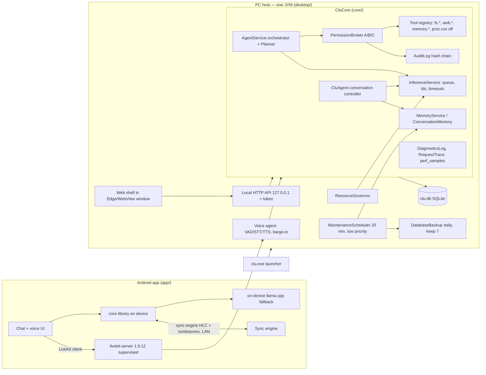

# AEE Architecture Audit — what CLU actually is today

_Milestone 2 (architecture audit, no implementation). 2026-11-03. Branch `claude/clu-android-ai-build-5cspi2`, HEAD `1fd8d98`._

Every finding below comes from reading source, Git history, or earlier test logs in this repository. Nothing was changed
in production code. Where a claim could not be verified, the text says so.

## 0. Method and evidence base

| Evidence | What was done |
|---|---|
| Repository layout and size | Files and lines counted per module (`find … | wc -l`) |
| Git | `git log`, `git branch -a`, `git status`. 86 commits on the working branch. 84 are authored by Claude sessions and 2 by the owner. Backup branches `backup/pre-m6-m7`, `backup/pre-m8`, `backup/clu-pre-livekit` exist. |
| Uncommitted work | `core/build.gradle.kts` (modified), `core/src/test/.../PerformanceBaselineTest.kt` and `docs/measurements/m1_performance_cold_cache.json` (untracked). These belong to the unfinished **Milestone 1 (Reliable Foundation)**. This audit leaves them untouched and does not commit them. |
| Tests | No new full run was made: Milestone 1 recorded a baseline in this session and its perf work is unfinished. Figures come from that baseline (§4) and from `docs/convergence/CONVERGENCE_STATUS.md`. |
| Source reading | `core/agents/*` (broker, orchestrator, tools, audit), `core/diag/*`, `core/db/Schema.kt`, `core/llm/*`, `desktop/ResourceGovernor.kt`, `MaintenanceScheduler.kt`, `DatabaseBackup.kt`, `HostMain.kt`, `installer/clu.nsi`, `installer/clu_launcher.c`, `legacy/primus/astra/{coding,testing,evaluation,deployment}` |
| Docs | `docs/convergence/*` (M0–M8.5 specifications and reports) and `docs/ARCHITECTURE.md` |

## 1. Repository at a glance

| Module | Language | Main / test lines | `@Test` count | Role |
|---|---|---|---|---|
| `core/` | Kotlin (JVM 17), no Android imports (enforced by `FoundationTest`) | 18,092 / 11,388 | 634 | The brain: identity, settings registry, SQLite storage (schema v6+), conversations, CluAgent controller, memory (M4), inference service (M5), agents, broker and audit (M7), research, sync, voice logic, diagnostics |
| `desktop/` | Kotlin (JVM) | 4,472 / 2,619 | 108 | PC host: `HostMain`, local HTTP API, setup wizard, model files, benchmark, resource governor, maintenance scheduler, DB backup, LiveKit voice (M8), web shell (`resources/shell/*.js`) |
| `app/` | Kotlin (Android, custom no-AGP build) | 8,898 / 1,406 | 53 | Android client: UI, Android voice I/O, services, Android tools, sync transport, on-device fallback engine |
| `native/` | C/C++ | 894 MB (sources plus builds) | — | llama.cpp and whisper.cpp JNI (arm64 and x86-64 Linux; Windows cross-built) |
| `installer/` | NSIS, C | — | static checks 24/24 | Per-user Windows installer, `clu.exe` launcher, bundled JRE |
| `legacy/primus/` | Python | 35,096 | (Primus' own) | Imported Astra/Primus code. **Not built, not wired, not run by CLU.** It includes a proposal-only coding agent, test workspace, evaluation and approval-bound deployment. |
| `bench/`, `testing/`, `contract/`, `scripts/` | mixed | — | — | PC benchmark pack (M1), test fixtures, the behavioral contract, build and verification scripts |
| `toolchain/` | — | 1.4 GB | — | Pinned JDK/SDK/NDK/Kotlin and voice toolchain for the custom builds |

## 2. Current architecture (as implemented)

## 3. Capability inventory relevant to autonomous evolution

The test applied is the one the brief asks for: does a complete, working capability exist end to end? A class with the
right name does not count.

| AEE responsibility | What exists (evidence) | End-to-end capability today | Classification |
|---|---|---|---|
| **A. System Observer** | `DiagnosticsLog` (bounded SQLite `diag_events`, redaction, level and cap from settings). `RequestTrace` per turn. `perf_samples` table. `PerfReport`. `ResourceGovernor.snapshot()` (RAM). `SystemProbe`. `MemoryHealth` (integrity, orphan counts). `/v1/requests` API. Status screens. | Records events and measurements and shows them on request. **No** baseline model of normal values, no anomaly detection, no incidents, no CPU, disk, thermal or crash monitoring, and no monitoring of repository or test state. | Partially implemented |
| **B. Architecture Intelligence** | `docs/ARCHITECTURE.md` (hand-written). `docs/SETTINGS_REGISTER.md`, generated from the settings registry. `FoundationTest` enforces "no Android in core". `apiCheck` and `icuRegexCheck` build checks. | **None at runtime.** CLU has no index of its own source, no symbol or dependency graph, no test↔component map, no knowledge of where its repository is, and no change reconciliation. | Missing |
| External development reconciliation | Git history exists, but CLU never reads it. No Git or file-watch code exists anywhere in `core/`, `desktop/` or `app/` (grep for `git`, `jgit`, `WatchService`, `FileObserver`: no hits). | None | Missing |
| **C. Diagnostics / root cause** | `ImprovementAdvisor`: four threshold rules (tool failure rate, first-audio, tokens/s, load time, ASR finalize) that become setting *suggestions*. RequestTrace stage timings. | Rule-based hints only, with no hypotheses, reproduction or experiments. | Partially implemented (seed only) |
| **D. Research** | `core/search`: Wikipedia, Brave, SearXNG, a pinned and validated page fetcher (DNS-rebinding-safe, robots-aware), multi-source evidence with conflicts and timestamps, untrusted-content wrapping. | Real and tested for *conversation* research. No paper or repository research, no license detection, no reproducibility assessment. | Implemented and verified for conversational research; Missing for engineering research |
| **E. Planning** | M7 `Planner` (grammar-constrained JSON plans). `AgentService` tasks (persisted, states, restart recovery). Memory "proposals" for owner approval. | Plans *one owner-given goal* into ≤20 tool steps. No goal *generation*, backlog, prioritisation or long-lived goals. | Partially implemented |
| **F. Coding** | `fs.read/list/stat/write/mkdir/delete` inside allowed roots, with trash and versions. `proc.run`: an allow-listed absolute exe, no shell, off by default, Category C every time, no OS sandbox. `legacy/primus/astra/coding` (Python, proposal-only, not wired). | No code understanding, no Git branches or worktrees, no patch generation, no build invocation. `proc.run` could start Gradle only with a per-call confirmation. | Missing (primitives exist) |
| **G. Build and test** | Gradle build (`./gradlew check`, custom Android pipeline, `apiCheck`, `icuRegexCheck`). Playwright UI tests. `scripts/verify_installer.sh`. Benchmark harnesses (`ModelBenchmark`, `PerformanceBaselineTest`, `bench/`). Primus `testing/` (Python, not wired). | Excellent *human-run* verification. CLU cannot run any of it on itself, and nothing parses results into records. | Implemented, insufficiently verified as an autonomous capability (verification exists only as developer tooling) |
| **H. Evaluation / metacognition** | Measurement JSONs in `docs/measurements/` (before/after pairs exist for M8.5, Stage 3, Stage 4). Claim-level answer validation in the conversation controller (Z2). Primus `evaluation/` (not wired). | Before/after comparison is a manual documentation practice. Nothing runtime compares versions. | Missing |
| **I. Deployment and recovery** | Installer upgrade backs up `clu.db` before replacing the program and never touches `%LOCALAPPDATA%\CLU`. Schema migrations are transactional and forward-only, and `Schema.migrate` refuses a newer DB. `DatabaseBackup` (create, verify, restore, keep 7). Restart via `Relauncher`. `clu.exe` launcher with a fixed `runtime\` and `lib\`. | One installed version, replaced in place. No side-by-side versions, no health-gated activation, no automatic rollback, no watchdog independent of the JVM. Restoring the DB is possible but manual. | Partially implemented |
| **J. Development knowledge** | `docs/` (human-readable history: 40+ documents, measurements). `tool_runs` reliability. Audit log. Memory system (M4) with categories `project` and `decision`. | Nothing CLU can query about its *own* development: bugs, fixes, failed attempts. The history exists only in Markdown and Git, which CLU does not read. | Missing |
| **K. Evolution scheduler** | `MaintenanceScheduler`: interval, minimum thread priority, skip while the model is busy or memory is short, checkpointed bounded jobs (`maintenance_jobs`). `ResourceGovernor.taskBlockReason()`. Window-aware governor (M6). `agents.maxTasks` and `maxParallel`. | A sound pattern for polite background work. It does not detect user idleness (only model busy and RAM), CPU, thermal state, working hours or disk, and it has no backlog. | Partially implemented (good foundation) |
| **Permission and trust** | `PermissionBroker`: categories A/B/C, once/task/standing grants, C never grantable, real-path root checks before approval, revocation checked at use, approvals expire at restart. Hash-chained append-only `audit_events` with SQLite triggers. Untrusted-data wrapping plus the structural rule that "plans are fixed before untrusted text is read". An obedient-model injection test. | Strong for owner-initiated tasks. The broker lives in the same process and source tree that a self-modifying CLU would edit, so it is **not yet outside the control of the modified code**. No OS-level sandbox. No notion of an "evolution workspace". | Implemented and verified for M7 scope; Architecturally unsuitable as the AEE trust anchor without relocation (§5) |
| Intelligence interface | `LlmEngine` interface. `InferenceRouter` (local or remote home device). `InferenceService` queue with owners and priorities. One model shared by chat, memory, planner and agents (asserted by test). | Replaceable backends exist. The current models (Qwen3-0.6B, SmolLM2-135M, a 1B test shape) are **far too weak for code repair**. The 1B is random-weight. | Implemented and verified (interface); Missing (capable coding model) |
| Phone ↔ PC identity | Sync engine (HLC, tombstones, encrypted bundle). Phone as LiveKit client of the PC. Pairing with device keys. `REMOTE_INFERENCE` fallback. | Works on Linux. Not run on a real phone against a Windows PC. Archive tables are not synced. | Implemented, insufficiently verified |

## 4. Test and verification state (evidence)

* **Milestone 1 baseline in this session** (untouched code, `./gradlew check :app:assembleDebug --offline --continue`): core green (623 tests at that point), app 74 green, `apiCheck` and `icuRegexCheck` pass. **Desktop: 16 of 108 failed.** The root cause was a memory probe that read total RAM from a cgroup-aware JVM but available RAM from `/proc/meminfo`. It was fixed in `1fd8d98`, and the affected classes pass when run individually. A full green re-run after that fix **has not been recorded yet**: it is pending Milestone 1.
* M8 final check: core 606, desktop 104, app 74, 0 failures (`CONVERGENCE_STATUS.md`).
* **Nothing has run on the target Windows PC** (Ryzen AI 7 350, Radeon 860M, 32 GB RAM). The M1 benchmark pack is still "waiting on the run on your PC". No measured model or backend choice exists for that hardware.
* **Nothing has run on a physical Android device** in these sessions (Xiaomi Pad 6, iQOO Neo 9 Pro are named as targets).

Lesson for the AEE: the existing suite *found* real cross-environment defects (cgroup memory, an ICU regex, Android-only
APIs). The suite is CLU's most valuable asset for autonomous verification. It is also not hermetic: desktop tests depend
on host memory and timing.

## 5. Technical limitations that shape the AEE

1. **Model capability is the binding constraint.** No model available here can write a correct non-trivial Kotlin patch. With 16 GB as CLU's ceiling on a 32 GB PC, a 7B–14B coder model at Q4 (roughly 4.5–9 GB with context) fits only while the chat model is unloaded or small. These sizes are estimates, not measured on the target. Autonomy must be gated on *measured* repair ability (see the roadmap, gate G0).
2. **The trust anchor is in the code that would be modified.** The broker, audit and settings are ordinary Kotlin in `core/`. A self-modifying CLU could weaken them in a patch that tests still accept. The policy and its enforcement must move *outside* the modifiable tree (a supervisor process plus an OS boundary).
3. **There is one installed copy, replaced in place.** `clu.nsi` deletes `$INSTDIR\lib` and `runtime` and copies the new ones. A broken self-built version would leave nothing to fall back to.
4. **Schema migrations are forward-only.** Rolling back the binary after a migration requires restoring the pre-migration backup, which loses data written since. Migrations need an expand/contract discipline or owner confirmation.
5. **The build is heavy.** The Android build runs a custom pipeline over a 1.4 GB toolchain. In this container a full `check` takes many minutes and contends with the CPU. On the PC it must run at low priority and be pausable.
6. **Single-process host.** Voice, chat, agents and maintenance share one JVM and one model. Building and testing CLU in a separate process is required anyway (a Gradle daemon), which is a natural isolation point.
7. **The Python code under `legacy/primus/` is unwired.** Its change pipeline is a design reference (empty evidence is never a pass, snapshots, approval-bound rollback). Running it would add a Python runtime CLU does not otherwise need.
8. **Documentation drift.** `CONVERGENCE_STATUS.md` totals differ from current counts (core 606 then, 634 `@Test` annotations now). Hand-written docs cannot serve as the architecture source of truth; derived indexes must.

## 6. Missing information (explicit)

* The **original eight milestones**. This audit takes them to be the convergence milestones M1–M8 (`docs/convergence/M1_…` to `M8_…`), whose specifications live in `CONVERGENCE_AUDIT.md` §6. Their full original owner briefs are not stored verbatim in the repository, only as implemented reports. If the owner meant a *different* set of eight (for example the new series that began with "Milestone 1: Reliable Foundation"), only Milestone 1's brief has been provided and the other seven are **missing**. See `AEE_CONSOLIDATION_MATRIX.md` §0.
* Primus/Astra ADRs (`docs/adr/`) and its Git history were missing at convergence time and still are.
* Windows PC measurements: none exist.
* Real-device Android results: none exist.
* The owner's intended repository host for CLU's own development. The PC holds no clone yet as far as this repository shows; GitHub is the only known remote.
