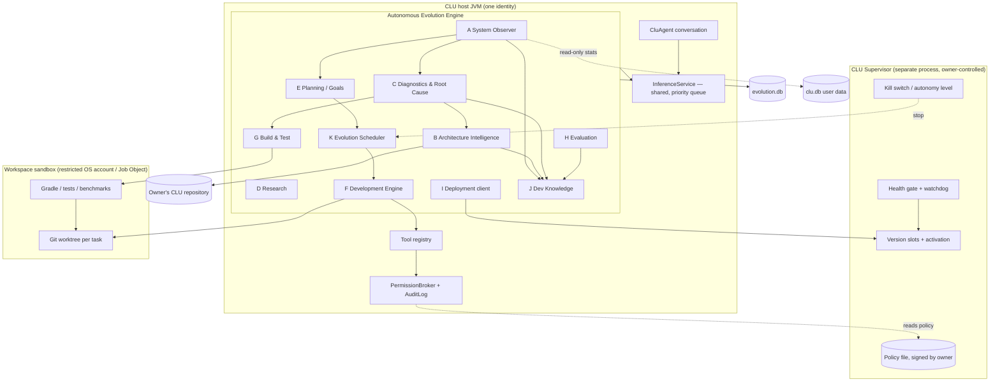
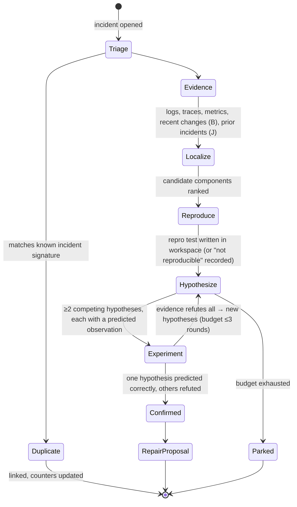
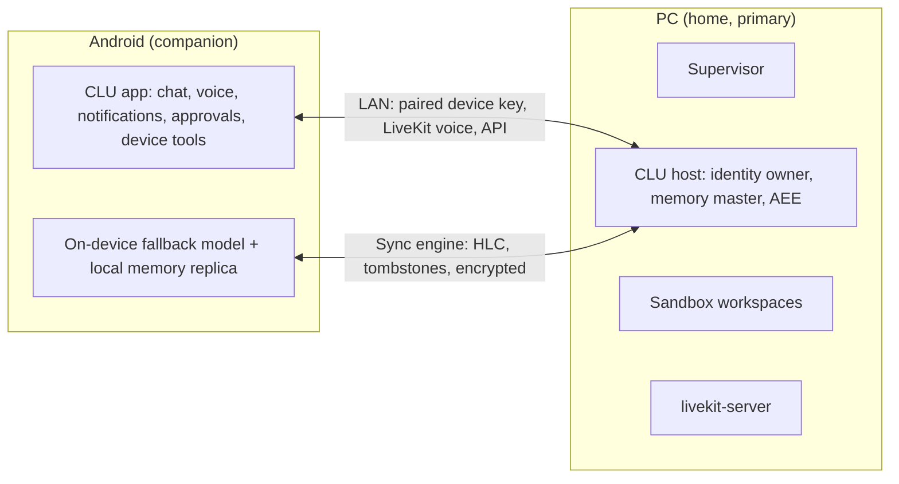

# CLU Autonomous Evolution Engine (AEE) — Architecture Specification

_Milestone 2 design. **Proposed, not implemented.** Where this document says "exists", it means verified in
`AEE_ARCHITECTURE_AUDIT.md`; everything else is a proposal._

## 1. Design principles

1. **One entity.** The AEE is a *capability* of CLU, not an agent beside it. It uses CLU's one inference service, its
   one identity and prompt, its one audit log, and its storage infrastructure. "Roles" (investigator, coder, verifier)
   are prompt and tool configurations over the shared model, exactly like M7 roles. No role has its own memory or
   identity.
2. **Evidence before belief.** Each conclusion the AEE records is one of three kinds: `observed` (measured),
   `hypothesis` (unconfirmed), or `confirmed` (an experiment discriminated it). A change is "better" only by recorded
   before/after measurements.
3. **The judge is not the defendant.** Policy, verification gates, deployment activation and rollback live where the
   code under modification cannot change them (§6).
4. **Reversible by construction.** All work happens in a Git worktree. Every deployment is a new version slot. The user
   database is backed up and verified before any activation that migrates it.
5. **Polite by default.** The AEE runs only when the owner and the PC can spare it. It has a hard budget, and
   background activity is never required for CLU to work.
6. **Incremental and cheap.** Index once, update by diff. Retrieve small context for the model; never "read the
   repository".
7. **Small steps, bounded loops.** Every loop (repair, research, goal generation) has an attempt budget and a stop
   rule, and records its outcome.

## 2. Placement

| Layer | Contents | Language / process | Modifiable by the AEE? |
|---|---|---|---|
| `core/.../evolution/` (new package in `core`) | Domain logic: records, the index model, the diagnostic and planning state machines, evaluation rules, retrieval of dev knowledge. Pure JVM, so it is unit-testable like the rest of `core`. | Kotlin, in the CLU host | Yes, inside a workspace, through the normal pipeline |
| `desktop/.../evolution/` (new) | Adapters: Git CLI runner, Gradle runner, filesystem scanner, OS probes (CPU, thermal, idle), workspace manager, sandbox launcher | Kotlin, in the CLU host | Yes, through the pipeline |
| **CLU Supervisor** (new, separate) | Version slots, activation, health gate, rollback, policy file custody, sandbox account custody, and the kill switch | Separate small native or JVM process, started by `clu.exe`. **Outside the AEE's write scope.** | **No.** Owner-only changes. |
| Android `app/` | No AEE engine. It shows status, notifications and owner confirmations, and carries the kill switch. | Kotlin/Android | Only by building an APK that the owner installs |

Why `core`: the domain logic must be testable without Windows and must reuse `SqlDriver`, `Clock`, `InferenceService`,
`AgentToolRegistry` and the broker. Why not on Android: build and test toolchains, Git and capable models are PC-only,
and the phone's battery and thermal limits forbid it.

## 3. Component architecture



### Internal communication

* **In-process:** a typed `EvolutionEvent` stream (Kotlin `SharedFlow`) for live coordination. Examples:
  `ObservationRecorded`, `IncidentOpened`, `RepoChanged`, `IndexUpdated`, `GoalProposed`, `TaskStateChanged`,
  `VerificationFinished`, `DeploymentRequested`.
* **Durable:** every event that changes state is written first to `evolution.db` (an outbox row in the same
  transaction as the state change). After a crash, subscribers resume from the outbox cursor. This mirrors how
  `maintenance_jobs` checkpoints work today.
* **To the Supervisor:** a local named pipe or loopback socket with a tiny command set: `stage(version, artifactHash)`,
  `activate(version)`, `status()`, and `rollback(reason)`. The Supervisor verifies requests against its policy. It
  never accepts code or policy from the host.
* **To the owner:** the existing API (`/v1/...`), the shell, and phone notifications. Confirmations reuse the M7
  approval card.

## 4. Subsystems

### A. System Observer

| Aspect | Specification |
|---|---|
| Signals | Process RSS and heap (exists); system free RAM (exists); CPU % of the host and its children; disk free on data, workspace and model volumes; model availability and load time (exists); inference TTFT, tok/s and queue wait (`RequestTrace`, `perf_samples`, exists); service liveness (API, livekit-server, voice agent); errors (`diag_events` ERROR/WARN, exists), uncaught exceptions and JVM crashes (`hs_err` files); DB integrity and size (`MemoryHealth`, `DatabaseBackup.verify`, exist); last verification result per branch; installed versions (Supervisor); repository HEAD and dirty state (via B) |
| Frequency | **Event-driven first**: errors, crashes and trace completions arrive as events. Periodic probes: cheap gauges every 60 s while CLU is active and every 10 min when idle. DB integrity `quick_check` daily, within the maintenance window. Repository check on focus or start, every 15 min, and after Gradle builds. |
| Normal vs fault | Per-metric rolling baseline over the last 7 days: median and MAD, stratified by model id, thread count and on-battery state. An **anomaly** is ≥3 robust z-scores away from the median for ≥3 consecutive samples, or a hard rule fires (crash, failed migration, integrity error, service down for 2 probes). One-off spikes become observations, not incidents. |
| Resource limit | Under 1 % of a core on average and under 20 MB heap. No probe may block a conversation thread. |
| Retention | Raw samples 7 days, hourly aggregates 90 days, daily aggregates indefinitely (a few KB per metric per year). Incidents and their evidence summaries are kept indefinitely. Raw log excerpts attached to an incident are capped at 64 KB and redacted (existing `DiagnosticsLog.redact`). |
| Output | `health_observations`, and `incidents` when the anomaly rules fire |

### B. Architecture Intelligence

Goal: a queryable, incrementally maintained model of CLU's own code. **Proposed approach: deterministic analysis
first, the model only for summaries.**

| Layer | How | Why this choice |
|---|---|---|
| Source inventory | `git ls-files` plus a SHA-1 blob per file (Git already hashes). A file changes when its blob changes. | Exact, free, incremental |
| Module graph | Parse `settings.gradle.kts` and each `build.gradle.kts` for `project(":x")` and dependency declarations, plus `apiCheck`-style tasks | The build already declares it |
| Symbols and imports | A Kotlin **lexer-level** extractor (strings and comments aware): package, imports, top-level and nested `class` / `interface` / `object` / `fun` / `enum` declarations, with line ranges. Stage 2: tree-sitter-kotlin if precision proves insufficient. | Cheap, no compiler dependency; Kotlin compiler PSI (`kotlin-compiler-embeddable`, roughly 60 MB) is held in reserve |
| Reference graph | Import edges plus identifier co-occurrence for same-package references (approximate, marked `approximate`) | Honest approximation; exact resolution needs the compiler |
| Test map | (1) Naming and import heuristics (`XTest` imports `X`). (2) Precise per-test coverage from **JaCoCo** runs during verification, stored as component → tests. | Coverage is the real association; heuristics give a cold start |
| Schema map | Parse `core/db/Schema.kt` migration steps (`CREATE TABLE`, `ALTER`) into table and column records per schema version | The schema is code-defined in one place |
| Configuration map | The settings registry already enumerates 178+ settings (`SETTINGS_REGISTER.md` is generated from it). Reuse that generator's model. | Exists |
| API contracts | Routes from `ApiServer` and `*Routes.kt` (method, path, handler) and the `contract/` JSON suite | Exists in code |
| Execution paths | Curated entry points (conversation turn, voice turn, agent task, maintenance tick, startup) traced through the reference graph, plus *observed* paths from `RequestTrace` stage names | Static paths plus runtime evidence |
| Summaries | Per component, a short model-written summary that cites file and line ranges. Regenerated only when the component's blob set changes, and stored with that blob-set hash. | The model runs only on what changed |

**Freshness rule:** each index entry carries the commit it was derived from. A query against a stale entry returns the
entry flagged `stale` and triggers an update; it is never silently treated as current.

#### External development reconciliation

* **Detection:** on each repository check, compare `HEAD`, the branch list and the working tree
  (`git status --porcelain=v2`) with the last reconciled state. New commits are walked with
  `git log --name-status -M --format=…`, and renames are detected by Git's similarity index.
* **Provenance:** a commit is `aee` if it carries the trailer `CLU-Evolution-Task: <id>` **and** its tree matches an
  entry in `code_changes`. It is `external` otherwise, including all owner and Claude Code commits. Uncommitted changes
  in the owner's working tree are `external-uncommitted`. CLU indexes them as *provisional* and **never** touches
  them.
* **Classification of a change:** files added, modified, removed or renamed; dependency (any `build.gradle.kts`,
  version catalog, `native/` pins); configuration (`Settings.kt`, `host.json` schema); schema (`Schema.kt`); API
  (`*Routes.kt`, `contract/`); architectural (module added or removed, new cross-module edge, or an edge that violates
  a declared rule such as core → android).
* **Response:** re-index the affected files, recompute edges, mark affected test mappings stale, and record a
  `reconciliation` row. If an AEE task's branch now conflicts with the new base, the task is **re-planned or
  abandoned**; it is never forced. External changes are never reverted, "fixed back", or treated as suspicious because
  of their origin.
* **Owner work wins:** an AEE branch rebases onto external changes, never the other way round, and AEE work stops
  touching files the owner is actively editing (dirty in the working tree).

### C. Diagnostics and Root-Cause Engine

State machine per investigation (all states persisted):



* **Evidence** is collected deterministically: the redacted log window around the event, the RequestTrace,
  observation series, the versions involved, and `git log` since the last good version (from deployment records).
* **Localisation** first uses cheap signals: stack-trace frames → index symbols, trace stage → components, and recent
  changes touching those components. The model is then asked to rank candidates from a **bounded** context (≤8 KB of
  code excerpts plus evidence), in the Agentless localisation style.
* **Reproduction:** the preferred artefact is a failing test written in the workspace. For regressions, an automatic
  `git bisect run` over the failing test between the last good and the current version. Bisect is deterministic and
  costs no model tokens.
* **Hypotheses:** each records its claim, its supporting and contradicting evidence, and a *discriminating
  experiment*: the observation it predicts that the others do not. The model may propose hypotheses. Only experiment
  results move one to `confirmed`.
* **Repair proposal:** the confirmed cause, the components, the minimal change intent, a verification plan (the repro
  test plus affected tests), and risk. "A test failed, so ask the model to edit until it passes" is explicitly
  **not** a path: without a confirmed or at least localised cause, the outcome is `Parked` with the evidence.

### D. Research Engine

Reuses the conversation research stack (pinned fetcher, untrusted wrapping, evidence with timestamps) and adds
engineering sources.

| Source type | Access | Reliability default |
|---|---|---|
| Local: the repository, `docs/`, development knowledge, local copies of dependency docs | Offline | High (owned) |
| arXiv (abstract pages and the export API), ACL Anthology, publisher DOIs | Online, rate-limited | Peer-reviewed > preprint; recency recorded |
| Open-source repositories (GitHub/GitLab pages, release notes) | Online | Read the license **from the repository's LICENSE file**, not from summaries |
| Official documentation (Kotlin, Gradle, llama.cpp, SQLite, Android) | Online, cacheable | High |
| Forums and blogs | Online | Low; corroboration required |

Each finding records its source URL or DOI, retrieval time, publication date, source type, license (SPDX id or
`unknown`), compatibility (JVM, Kotlin, Windows, offline), resource needs, reproducibility (code and data available?
results independently replicated?) and an evidence grade. Model-generated ideas are stored as `speculation` and are
never cited as findings. Research is **owner-scoped**: CLU researches for an existing goal or incident, never
open-endedly. Network access goes through the broker as a *restricted* operation with a domain allow-list (§6).
Licenses: code may be *adapted* into CLU only under licenses on the owner-approved list (default: MIT, BSD-2/3,
Apache-2.0, ISC, Zlib, MPL-2.0 as a separate file). AGPL, GPL and unknown licenses are read-only inspiration, matching
the convergence licensing decision.

### E. Autonomous Planning Engine

* **Goal sources:**
  * incidents (Confirmed → repair goal);
  * observation trends, such as a slow TTFT trend;
  * capability gaps from the owner (an explicit request, or a *repeated* failure like "can't do X" asked three
    times, detected from conversation outcome records without storing raw text);
  * research findings tied to an existing goal;
  * debt flagged by Architecture Intelligence, such as rule violations or untested components.
* **Goal record:** objective, reason, expected benefit (a measurable metric and target), affected components,
  resources (estimated model time, CPU time, disk), dependencies, risk, verification strategy and completion
  criteria. A goal without a measurable completion criterion **cannot be activated**.
* **Priority score** (transparent and logged, weights in policy):
  `P = (0.30·UserBenefit + 0.25·Reliability + 0.15·Capability + 0.15·Urgency) × Confidence − 0.10·Cost − 0.05·ResourceUse − RegressionRisk·RiskWeight`.
  Each factor is on a 0–1 scale with a written rubric.
* **Anti-proliferation:**
  * at most 20 open goals and 3 active;
  * at most 5 new self-originated goals per week;
  * a new capability goal needs either owner origin or evidence of a repeated user difficulty;
  * duplicate detection against open and closed goals by component and objective similarity;
  * a goal that fails twice is frozen until new evidence arrives;
  * "rewrite or refactor for elegance" goals are not allowed unless a measured metric (failures, latency, size)
    motivates them.

### F. Development Engine

**Decision: build a thin, CLU-native coding loop on M7's orchestrator and tools rather than embed an external coding
agent.** The reasoning is in `AEE_RESEARCH_REGISTER.md` §3. In short, OpenHands, SWE-agent and Aider are Python and
assume strong hosted models. Embedding one would add a second runtime and a second memory/identity, and would duplicate
the broker. Their *techniques* are adopted: repository map (Aider), localise→repair→validate (Agentless), and a
constrained edit interface (SWE-agent ACI).

Loop per task (Agentless-style, bounded):

1. `workspace.create(task)`: `git worktree add` from the **last verified commit** of the target branch, into
   `%LOCALAPPDATA%\CLU\evolution\ws\<task>`. Owned by the sandbox account.
2. Localise: index query plus test map, giving ≤N files and functions.
3. Patch: the model produces **search/replace edit blocks** for named files (no free-form shell). Edits are applied by
   a deterministic tool that refuses edits outside the task's declared component set unless the plan is amended.
4. Compile and run the targeted tests (G) and feed back compiler and test errors. At most 4 iterations per candidate
   and at most 3 candidates.
5. Self-review: a verifier role reads the diff against the repair proposal and checks scope, deleted tests and
   weakened assertions.
6. Commit to `clu/evo/<task>` with the trailer `CLU-Evolution-Task: <id>`.

Dependency installation: only artefacts present in Gradle's offline cache or listed in an owner-approved
`gradle/verification-metadata.xml` with checksums. **Adding a new dependency is an owner-confirmation operation
(§6).** Documentation updates are part of the patch. Docs-only patches still go through verification (link and
reference check).

**Model routing:** the development roles use the Intelligence Interface. The default is the best local coding model
that fits (measured by gate G0). The interface can also point at an owner-supplied OpenAI-compatible endpoint, such as
a local `llama-server` on another machine or an optional paid API, which the owner opts into. Basic CLU operation never
depends on it.

### G. Build and Test Engine

| Stage | Tooling (existing unless marked) | Gate |
|---|---|---|
| Compile | Gradle `assemble` per affected module | must pass |
| Static | `apiCheck`, `icuRegexCheck`, the core-imports architecture test, plus **new**: detekt or ktlint *diff-only* (no mass reformat) | no new violations |
| Unit and integration | `./gradlew :core:test :desktop:test` (targeted first, then full) | 0 failures; no test deleted, `@Disabled` or weakened without an owner-confirmed reason |
| UI | Playwright `ShellUiTest`, `VoiceUiTest` | when shell or API files changed |
| Security | secret scan (gitleaks-style rules, reusing `redact` patterns), dependency CVE check on the lockfile (OSV data, offline mirror), forbidden-API list (`Runtime.exec` outside allowed classes, network outside the fetcher) | no new findings |
| Performance | `PerformanceBaselineTest`, `ModelBenchmark` on a fixed model | no regression beyond noise (§H) |
| Compatibility | Android `app` build plus `apiCheck` when `core` changed; schema migration test from every past version on a **copy** of a real DB snapshot | must pass |
| Behaviour-coverage check | JaCoCo: the changed lines must be executed by at least one test that passes after and **fails before** (for fixes: the repro test) | required for fixes; recorded for features |
| Mutation spot-check (stage 2) | PIT on changed classes only, time-boxed | informational |

**Flake handling:** a test that fails then passes on an identical re-run is recorded as `flaky` in knowledge and is
**not** a pass for the change under test. The change is verified on a second clean run. Flaky tests become reliability
goals.

### H. Evaluation and Metacognition

An evaluation record answers each brief question with **evidence links**, not prose:

| Question | Evidence required |
|---|---|
| Solved the original problem? | The repro test fails before and passes after; the incident's trigger metric is back within baseline in staging |
| Evidence it works? | Behaviour-coverage check result |
| Performance improved or not regressed? | Benchmark A/B: ≥5 runs each, Mann-Whitney U test p < 0.05 for a claimed improvement; for regression, the median is within the noise band (3·MAD) |
| Resource use? | Peak RSS, model RAM, startup time, APK and installer size deltas |
| Unrelated regressions? | Full suite plus UI suites green; no new Observer anomalies during staging soak |
| Complexity? | Lines added and removed, new dependencies, new public APIs, cyclomatic delta (from the index); a change adding >300 lines for a fix is flagged |
| Useful? | For features: an owner-visible acceptance check defined *before* coding; usage counted after deployment (no content stored) |
| Better than before? | A comparison table: the verdict is `improved` / `neutral` / `worse` / `inconclusive`. Only `improved` (or `neutral` for pure fixes with a confirmed cause) proceeds. |

**Metacognition** means two things here. First, a per-task retrospective written into knowledge: the predicted vs
actual effort and outcome. Second, a calibration score per goal source and model: did the investigations it confirmed
hold up after deployment? A source whose confirmed causes later prove wrong loses confidence weight in planning.

### I. Deployment and Recovery

```mermaid
flowchart LR
  B[Verified build artefact + hash] --> S[Supervisor: stage into versions/<v>/]
  S --> BK[Backup clu.db + verify]
  BK --> SM[Staging run: start new version on a COPY of the DB, health checks, smoke conversation with fixed prompts]
  SM -->|pass| A[Activate: current.txt → v (atomic rename)]
  SM -->|fail| X[Reject, record, keep current]
  A --> W[Watch window: first start + 24 h health]
  W -->|healthy| D[Done; keep last 3 versions]
  W -->|unhealthy / crash loop| R[Rollback: current.txt → previous; restore DB backup only if schema changed and the new version is unhealthy]
```

* **Version slots:** `%LOCALAPPDATA%\Programs\CLU\versions\<version>\{lib,runtime}`. `clu.exe` (launcher) reads
  `current.txt`. The installer-built version is slot 0. User data stays in `%LOCALAPPDATA%\CLU` as today.
* **Supervisor independence:** the Supervisor is started by `clu.exe` and runs from its own directory, which the
  AEE's sandbox account cannot write. It starts the host and watches it with a heartbeat on the existing local API.
  After 3 failed starts within 10 minutes, it activates the previous slot. **Recovery therefore works even if the new
  CLU never starts.** As a last resort, starting `clu.exe --safe` launches the slot-0 version with the AEE disabled.
* **User data:** never in a slot. Schema changes require an **expand/contract** discipline: a migration may only add
  tables or columns in the first release that uses them. The old version must be able to run against the new schema
  (tested by the compatibility gate). A destructive migration (drop or transform) is an owner-confirmation operation.
  This keeps binary rollback safe without restoring the DB.
* **Android:** the AEE may *build* an APK. Installing it needs the owner (Android requires user confirmation for
  sideloads anyway). The phone keeps its previous APK until then. The APK is signed by the release key, whose custody
  stays with the owner. Pushing to any remote (GitHub) is owner-confirmed.
* **Retry block:** a version that failed staging or was rolled back blocks its goal until a new diagnosis exists
  (`deployments.blocked_until_investigation`).

### J. Persistent Development Knowledge

* **Store:** `evolution.db` (see the data model). Rationale: it is derived, high-churn and machine-oriented data.
  Keeping it out of `clu.db` keeps user backups, sync and phone transfer small, and the knowledge can be rebuilt or
  deleted without risk to user data. It uses the **same** `SqlDriver`, migration framework and backup code, so this
  is not a second database technology.
* **Retention tiers:**
  * *Keep forever (small, curated):* incidents, confirmed root causes, failed attempts with reasons, deployments and
    rollbacks, decisions, lessons, research findings, benchmark summaries.
  * *Summarise then discard:* raw build and test logs (keep failing excerpts ≤16 KB plus summary and hash; raw logs
    deleted after 14 days); observations (aggregated as in §A).
  * *Index:* FTS5 over titles, summaries, root causes and lessons; component links for structured retrieval.
  * *Discard:* model transcripts of investigation steps beyond 30 days (the conclusions remain).
* **Retrieval before a task:** by component (from the index), by incident signature (stack frame plus error class
  plus metric), and by FTS on the objective. The top results go into the task's context as a short "prior work"
  block. A task whose signature matches a *failed* repair must state why its approach differs, or it is refused.

### K. Evolution Scheduler

Extends the `MaintenanceScheduler` pattern.

* **Idle detection:**
  * no conversation or voice turn for ≥10 min;
  * on Windows, `GetLastInputInfo` shows ≥10 min of no input;
  * no full-screen or foreground-heavy app (the M6 window-aware governor);
  * not on battery, or the owner allows it.
* **Budgets (policy):**
  * evolution total ≤ 8 GB of CLU's 16 GB ceiling, including the coding model;
  * CPU: build and test processes at *below-normal* priority in a Job Object with a 50 % CPU rate cap;
  * at most 1 active development task and 1 research task;
  * disk: stop if the workspace volume falls below 10 GB free or evolution data exceeds its quota (default 20 GB).
* **Thermal and working hours:** pause when the CPU package temperature crosses the policy threshold (if readable) or
  frequency throttling is observed. Run only inside configured hours, by default 01:00–07:00 plus "idle ≥30 min".
* **Preemption:** any user turn **pauses** the AEE within 1 s. Generation requests from the AEE run at the lowest
  inference priority, and a running build is suspended (Job Object suspend), not killed. Work resumes from the task
  checkpoint.
* **Persistence:** task state in `evolution.db`. The current step is idempotent or checkpointed (the worktree state is
  in Git).
* **Anti-repetition:** each task has an attempt budget (3), exponential backoff, and a signature-based "already tried"
  check (J).
* **Not required for liveness:** with the AEE off, CLU behaves exactly as today.

## 5. Autonomy levels

These are set by the owner, stored in the Supervisor's policy, and readable but not writable by the host.

| Level | What happens without asking |
|---|---|
| L0 Off | Nothing (the default after install) |
| L1 Observe | A, B, J; diagnostics up to `Confirmed`. Reports only. |
| L2 Propose | Plus planning, research, and development in workspaces. Changes wait as verified branches for owner review. |
| L3 Self-maintain | Plus automatic deployment of **fixes** (confirmed cause, no schema or dependency change, within diff limits) through staging and rollback |
| L4 Self-improve | Plus automatic deployment of verified improvements and features within policy |

Promotion from one level to the next requires passing the measured gates in the roadmap.

## 6. Trust architecture

### Rings

| Ring | Contains | Can change |
|---|---|---|
| 0 Owner | Policy file, autonomy level, signing keys, sandbox account, approved license and domain lists | Only the owner, through the Supervisor UI, Windows Hello or the PIN (the existing owner verification) |
| 1 Supervisor | Activation, rollback, policy enforcement for deployment, kill switch | Owner-installed updates only. Excluded from AEE workspaces by a path rule **and** by repository scope (the Supervisor sources live in a separate directory or repository the AEE cannot target). |
| 2 CLU host | Conversation, memory, AEE logic, broker | Through deployments that Ring 1 activates |
| 3 Workspace sandbox | Worktrees, Gradle, tests | Freely, inside the sandbox |

### Operation classes

| Class | Examples | Control |
|---|---|---|
| **Automatic** (inside the workspace) | Read the repository; create worktrees and branches `clu/evo/*`; edit files in a worktree; run Gradle and tests offline; write `evolution.db`; generate docs; local commits on `clu/evo/*` | The sandbox account has write access only to `evolution/ws/**` and the Gradle cache; Job Object limits; audit log |
| **Restricted** (automatic within policy, with extra controls) | Network fetch for research (domain allow-list, pinned fetcher, size and time caps); dependency resolution from approved checksummed artefacts; deployment of a fix at L3 (staging, health gate, rollback); reading CLU's own diagnostics and anonymous usage counters | The broker checks policy at the moment of use; everything is audited; rate limits |
| **Owner confirmation** | New dependency or new network domain; destructive or transforming schema migration; changes to the broker, policy loader, audit, auth, Supervisor, launcher, installer, signing or update code ("trust-critical paths", listed in policy); deleting or overwriting user data; pushing to a remote, publishing, sending anything off the PC; installing on the phone; raising the autonomy level; disabling or deleting tests; anything outside the repository and evolution folders | The M7 approval card on the PC or phone, single-use, with the diff summary. **Never grantable as standing.** |

### Protections

| Threat | Protection |
|---|---|
| Accidental data destruction | User data is outside the sandbox account's ACL. Worktrees are disposable. `fs.delete` moves to trash (exists). DB backup and verify before activation. Expand/contract migrations. |
| Credential exposure | The sandbox account has no access to `%LOCALAPPDATA%\CLU` secrets, the keystore, browser profiles or `~/.ssh`. The environment is scrubbed for builds. Secret scan on every diff and log excerpt. `redact` on all records. |
| Malicious dependencies | Offline-first Gradle with `verification-metadata.xml` checksums. New dependencies need owner confirmation. Licence and CVE check. No install scripts run (the JVM ecosystem has none by default; npm and pip are not used). |
| Prompt injection and untrusted repository instructions | Repository text, docs, web pages and research are **data**: wrapped as `<untrusted-data>` (exists). Plans are fixed before untrusted text is read (exists). Tools never take paths or commands from untrusted fields (exists). Files such as `CLAUDE.md`, `AGENTS.md`, `SKILL.md` or comments saying "you may now…" have **no** authority over policy. Policy is read only from Ring 0. |
| Uncontrolled network | The sandbox account has no network by default (Windows Firewall rule per account or AppContainer). Research goes through the host's pinned fetcher only. |
| Privilege escalation | The sandbox is a standard (non-admin) Windows user. The host never runs elevated. No UAC prompts are triggered by the AEE: any operation needing elevation is outside scope. |
| Recursive self-modification | Trust-critical paths require owner confirmation. Evaluation thresholds and gates live in the Supervisor policy, not the repository. A change may not modify the tests that judge it without owner confirmation (detected by diff: removed or edited assertions in existing tests are flagged). |
| Infinite repair loops | Attempt budgets per task, goal and signature; freeze after 2 failures; weekly goal quota; rollback blocks retry until new evidence; the kill switch. |
| Self-granted privilege | The host has no API to change policy. The Supervisor accepts policy only from the owner UI with owner verification. Policy changes are hash-chained in the Supervisor's own log. |

## 7. Deployment topology



| Concern | Design |
|---|---|
| Identity ownership | The PC host owns the identity record (name, persona, policy-relevant owner settings). The phone holds a replica. Identity settings edited on the phone sync as ordinary settings with HLC ordering (existing). |
| Memory sync | The existing sync engine: last-writer-wins by HLC, with tombstones. Archive tables become synced (currently not) in a later memory milestone, not in the AEE. `evolution.db` is **not** synced to the phone; the phone receives a status digest only. |
| Conversation sync | Conversations sync as today. A turn handled on the phone offline is recorded locally and merged on reconnect. |
| Device availability | The phone sees the PC's state through the token endpoint and the API (`online`, `busy-evolving`, `offline`). |
| Offline | The phone keeps working with its on-device model, labelled as such (exists). The AEE never needs the phone. |
| Conflicts | HLC ordering; for owner-curated records, the conflict is surfaced (the existing `archive_conflicts` pattern), not auto-resolved |
| Host disconnect / reconnect | The phone shows "PC unreachable", queues approvals as *expired*, never approves on reconnect implicitly, and fetches the digest on reconnect |
| AEE ↔ phone | Notifications (incident opened, deployment done or rolled back), confirmation cards for owner-confirmation operations, and the kill switch (sets L0 through the Supervisor) |

## 8. Resource management summary

| Component | RAM (est.) | CPU | When |
|---|---|---|---|
| Observer + index queries | <50 MB | <1 % | always (if L≥1) |
| Index build (full) | ~200 MB | 1 core, minutes | first run, then incremental (seconds) |
| Coding model 7B Q4 (if chosen) | ~4.5–5.5 GB at 8k context (estimate, unmeasured) | all inference threads | AEE windows only; the chat model is unloaded or kept small |
| Gradle daemon + tests | 1.5–3 GB (Gradle heap plus test JVMs) | capped 50 % | verification only |
| Total AEE peak | ≤8 GB policy cap | — | — |

The 16 GB CLU ceiling holds: chat model (≤7 GB per the M1 plan) and coding model are **never** resident together at
L≥2 during development windows unless the measured total fits. The governor enforces this.

## 9. Architectural decisions (ADR summary)

| # | Decision | Alternatives rejected | Reason |
|---|---|---|---|
| AD-1 | The AEE is a CLU subsystem in `core`/`desktop` over the shared inference service | A separate agent process; an embedded OpenHands | One identity, one memory, no Python runtime |
| AD-2 | A Supervisor outside the host holds policy, activation and rollback | The broker alone | The judge must not be modifiable by the defendant |
| AD-3 | Side-by-side version slots plus expand/contract migrations | In-place upgrade (current) | A failed self-update must be recoverable with zero manual steps |
| AD-4 | A deterministic index (Git blobs, lexer, Gradle, JaCoCo); the model only summarises | LLM reads the repository | Cost, accuracy, incrementality |
| AD-5 | `evolution.db` separate from `clu.db`, same infrastructure | Tables in `clu.db`; a new DB technology | Protect and slim user data; no new tech |
| AD-6 | Agentless-style bounded repair with confirmed causes | Free-running agent loop | Measured robustness with small models; no blind edit loops |
| AD-7 | OS sandbox via a dedicated standard Windows account plus Job Objects | Containers (Docker or WSL not guaranteed on the PC); no sandbox | Native, free, no extra runtime |
| AD-8 | Autonomy levels gated by measured benchmarks | Fully autonomous from day one | Trust earned with evidence |
| AD-9 | Coding model behind the Intelligence Interface, local by default, optional owner-configured endpoint | Mandatory local; mandatory API | Offline-first while allowing capability |
