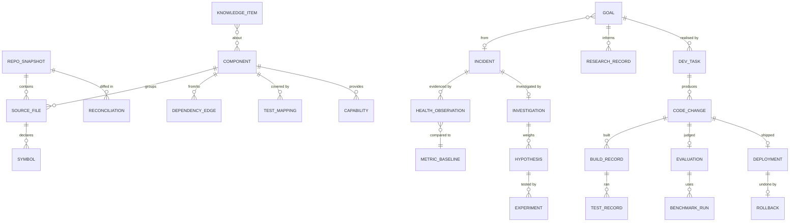

# AEE Data Model (proposed — no tables are created in this milestone)

## 1. Stores

| Store | Holds | Technology | Why |
|---|---|---|---|
| `clu.db` (exists) | User data: conversations, memories, archive, settings, audit log, agent tasks | SQLite via `SqlDriver`, `Schema.kt` migrations | Unchanged. The AEE only **reads** aggregates (perf samples, diag events, schema version) |
| `evolution.db` (new) | Everything below except policy | SQLite, same `SqlDriver`, its own `EvolutionSchema` migration list, same backup code | Derived and machine data, rebuildable, not synced, quota-bound |
| `policy.json` + `policy.log` (new, Supervisor) | Permission policy, autonomy level, gates, budgets, trust-critical paths, approved licenses and domains | JSON signed with an owner-verified HMAC key held by the Supervisor; an append-only hash-chained log | Must live outside the host's write scope (Ring 1) |
| Git (owner's repository plus AEE worktrees) | Code and code history | Git | The source of truth for code; never duplicated into SQLite except as hashes and summaries |
| Filesystem `evolution/artifacts/` | Build outputs, raw logs (14 days), JaCoCo exec files | Files, content-addressed by SHA-256 | Too large for SQLite |

**One fact, one home:** code lives in Git; the index stores hashes and derived structure; user data lives in `clu.db`;
development facts live in `evolution.db`. The audit log in `clu.db` remains the record of *permissioned actions*. The
AEE writes its tool calls there through the broker (exists) and references audit ids rather than copying them.

## 2. Entity relationship overview

## 3. Entities

Conventions:

* ids are text UUIDs;
* `*_at` fields are epoch milliseconds from the injected `Clock`;
* every table has a `created_at`;
* JSON columns are validated by kotlinx-serialization;
* every text field from models or logs is passed through `redact` before storage.

### Architecture index

| Entity | Purpose | Key fields | Relationships | Retention | Indexes |
|---|---|---|---|---|---|
| `repo_snapshots` | One reconciled state of the repository | id, commit, branch, dirty (bool), dirty_hash, reconciled_at, indexer_version | → source_files | Last 200 plus all deployed commits | (commit) unique |
| `source_files` | File inventory | path, blob_sha, module, language, lines, first_seen_commit, last_changed_commit, provenance (`external`/`aee`/`external-uncommitted`), removed_at | component; symbols | Current plus removed (for history) | (path), (blob_sha) |
| `symbols` | Declarations | id, file_path, blob_sha, kind (class/interface/object/fun/enum/property), fqname, start_line, end_line, visibility, signature_hash | file | Replaced on blob change | (fqname), (file_path) |
| `components` | Logical units: module → package → (optional) curated component such as "PermissionBroker" | id, name, kind (module/package/curated), path_globs, owner_rule (e.g. `trust-critical`), summary, summary_blobset_hash, summary_commit | files, edges, tests, capabilities | Persistent | (name) |
| `dependency_edges` | Module, package and import edges | from_component, to_component, kind (gradle/import/reference), precision (`exact`/`approximate`), commit | components | Recomputed per snapshot; history via snapshot id | (from), (to) |
| `architecture_rules` | Declared invariants, e.g. `core ↛ android.*` | id, rule (DSL text), source (doc or test), severity | — | Persistent | — |
| `test_mappings` | Which tests exercise which component | test_id (class#method), component_id, method (`name-heuristic`/`import`/`coverage`), confidence, measured_commit, stale (bool) | components | Latest per pair | (component_id), (test_id) |
| `capabilities` | User-visible capabilities and their status | id, name, description, components (json), status (`verified`/`insufficient`/`partial`/`missing`), evidence (json links to tests or benchmarks) | components | Persistent, versioned by snapshot | (name) |
| `schema_map` | Tables and columns by `clu.db` version | db, version, table, column, type, added_in | — | Persistent | (db, version) |
| `config_map` | Settings registry snapshot | key, type, default, scope, readers (json file list) | components | Per snapshot | (key) |
| `api_routes` | Local API surface | method, path, handler_symbol, auth, commit | symbols | Per snapshot | (path) |
| `reconciliations` | One external-change reconciliation | id, from_commit, to_commit, files_added/modified/removed/renamed (counts plus json), categories (dependency/config/schema/api/architecture), affected_components, tasks_replanned, at | snapshots | Persistent (small) | (to_commit) |

### Observation and diagnostics

| Entity | Purpose | Key fields | Relationships | Retention | Indexes |
|---|---|---|---|---|---|
| `health_observations` | Raw gauge samples | metric, value, unit, context (model_id, threads, power), version, at | baseline | Raw 7 days → hourly 90 days → daily forever (rollup tables `health_hourly`, `health_daily`) | (metric, at) |
| `metric_baselines` | Normal-range model per metric and context | metric, context_key, median, mad, n, window_days, updated_at | observations | Current plus monthly snapshots | (metric, context_key) |
| `incidents` | A detected fault | id, signature (hash of error class + top frames + metric), kind (crash/error-rate/perf-regression/service-down/integrity/test-failure), severity, first_seen, last_seen, count, version, status (`open`/`investigating`/`resolved`/`parked`/`duplicate`), duplicate_of, evidence_ref | investigation, goal | Persistent | (signature), (status) |
| `investigations` | Root-cause work | id, incident_id, state (per the state machine), candidates (json ranked components), repro (json: test id, workspace commit, result), bisect (json), conclusion, confirmed_hypothesis_id, budget_used, model_id | hypotheses | Persistent; step transcripts 30 days | (incident_id) |
| `hypotheses` | One competing explanation | id, investigation_id, claim, status (`proposed`/`refuted`/`supported`/`confirmed`), evidence_for (json), evidence_against (json), prediction | experiments | Persistent | (investigation_id) |
| `experiments` | Discriminating test | id, hypothesis_id, method (test/bisect/measure/config-toggle), command_ref, expected, observed, verdict, artifact_hash | — | Persistent (summary); artefacts 14 days | — |

### Planning and research

| Entity | Purpose | Key fields | Relationships | Retention | Indexes |
|---|---|---|---|---|---|
| `goals` | Improvement goal | id, title, objective, reason, origin (`incident`/`trend`/`owner`/`repeated-difficulty`/`research`/`debt`), origin_ref, metric, baseline_value, target_value, components (json), est_resources (json), dependencies (json), risk, verification_strategy, completion_criteria, priority, priority_breakdown (json), status (`proposed`/`approved`/`active`/`done`/`frozen`/`rejected`/`superseded`), failures, frozen_reason | tasks, research | Persistent | (status, priority) |
| `research_records` | One finding | id, goal_id, question, source_url, doi, source_type, published_at, retrieved_at, license_spdx, license_source (`LICENSE file`/`metadata`/`unknown`), compatibility (json), resource_needs, reproducibility (`code+data`/`code`/`none`), evidence_grade (A–D), kind (`finding`/`speculation`), summary, content_hash | goal | Persistent; cached page text 30 days | (goal_id), FTS(summary) |

### Development and verification

| Entity | Purpose | Key fields | Relationships | Retention | Indexes |
|---|---|---|---|---|---|
| `dev_tasks` | Unit of development work | id, goal_id, kind (`repair`/`feature`/`perf`/`docs`/`test`), state (`queued`/`localizing`/`editing`/`verifying`/`evaluating`/`awaiting-owner`/`deploying`/`done`/`failed`/`paused`/`abandoned`), base_commit, branch, worktree_path, allowed_components (json), attempt, max_attempts, checkpoint (json), paused_reason, autonomy_level_at_start | goal; changes | Persistent | (state) |
| `code_changes` | One candidate patch | id, task_id, commit, parent_commit, diff_stats (files, +, −), touched_components (json), trust_critical (bool), tests_modified (json), new_dependencies (json), schema_change (`none`/`expand`/`destructive`), summary | task; builds; evaluation | Persistent; diff in Git | (task_id), (commit) |
| `build_records` | One build | id, change_id, commit, command, tool_versions (json), started_at, duration_ms, result, failing_excerpt (≤16 KB), log_artifact (hash, 14 days) | change; tests | Summary persistent | (change_id) |
| `test_records` | Results per run | id, build_id, suite, test_id, result (`pass`/`fail`/`skip`/`flaky`), duration_ms, failure_excerpt | build | Per-test rows 90 days; suite aggregates persistent | (test_id, result) |
| `coverage_records` | Changed-line coverage | change_id, file, lines_changed, lines_covered, covering_tests (json), repro_fails_before (bool), passes_after (bool) | change | Persistent (small) | (change_id) |
| `benchmark_runs` | One benchmark (unifies `bench/`, `ModelBenchmark`, `PerformanceBaselineTest` outputs) | id, harness, commit, model_id, hardware_fingerprint, params (json), metrics (json: ttft_ms, tok_s, rss_mb, startup_ms …), runs, at | evaluation | Persistent | (harness, commit) |
| `evaluations` | Verdict on a change | id, change_id, solved (bool + evidence), coverage_ok, perf_verdict, resource_delta (json), regressions (json), complexity_delta (json), usefulness_check, verdict (`improved`/`neutral`/`worse`/`inconclusive`), comparison (json table), evaluator_model | change; benchmarks | Persistent | (verdict) |

### Deployment

| Entity | Purpose | Key fields | Relationships | Retention | Indexes |
|---|---|---|---|---|---|
| `deployments` | One activation attempt (written by the host as a request; the outcome is mirrored from the Supervisor's log) | id, change_id, version, artifact_sha256, from_version, db_backup_file, db_backup_verified, staging_result (json), activated_at, watch_until, outcome (`active`/`rejected-staging`/`rolled-back`/`superseded`), blocked_until_investigation (bool) | change; rollback | Persistent | (version) |
| `rollbacks` | Undo | id, deployment_id, trigger (`crash-loop`/`health`/`owner`/`metric`), to_version, db_restored (bool), data_loss_window_ms, at, notes | deployment | Persistent | — |

### Knowledge and policy

| Entity | Purpose | Key fields | Relationships | Retention | Indexes |
|---|---|---|---|---|---|
| `knowledge_items` | Curated development knowledge | id, kind (`bug`/`root-cause`/`failed-attempt`/`fix`/`architecture-change`/`dependency-decision`/`perf-measurement`/`lesson`/`flaky-test`), title, body (≤4 KB), signature, components (json), source_refs (json: incident, change, research, commit), confidence, valid_from_commit, superseded_by | components | Persistent; superseded items kept, ranked lower | FTS5(title, body), (signature), (kind) |
| `outbox` | Durable event stream | seq, type, payload (json), at, consumed_by (json) | — | 7 days after consumption | (seq) |
| `policy_cache` | Host's read-only copy of the Supervisor policy | version, hash, json, fetched_at | — | Latest | — |
| Supervisor `policy.json` | Policy (Ring 0/1) | autonomy_level, budgets, hours, gates (thresholds), trust_critical_globs, approved_licenses, approved_domains, approved_dependencies, max_diff_lines, goal quotas | — | Versioned in `policy.log` | — |

## 4. Migration strategy

* `evolution.db` has its own ordered migration list (the same mechanism as `Schema.kt`: one transaction per upgrade;
  refuses a newer version). It starts at v1 with the index and observation tables, and adds tables per roadmap
  milestone.
* **Expand/contract** applies to `clu.db` changes made by the AEE (§I of the spec), and the compatibility gate tests
  the old binary against the new schema.
* `evolution.db` is **rebuildable**:
  * index tables are regenerated from Git;
  * observations are lost safely;
  * knowledge, incidents, goals, deployments and rollbacks are the irreplaceable part, exported daily as JSON Lines
    into `evolution/export/` (the same retention as DB backups, keep 7).
* Deleting `evolution.db` never affects CLU's conversations or memory.

## 5. Size estimates (for the 32 GB PC; unmeasured)

| Data | Estimate |
|---|---|
| Index (~550 Kotlin files, ~10k symbols, edges) | 10–30 MB |
| Observations after rollup, 1 year | <50 MB |
| Knowledge, incidents, goals, tasks, 1 year | <20 MB |
| Artefacts (14-day raw logs, coverage) | 1–5 GB, quota-capped |
| Worktrees (each a checkout without `toolchain/`, sharing Git objects) | ~100 MB each plus build outputs (~1–2 GB); at most 2 kept |
