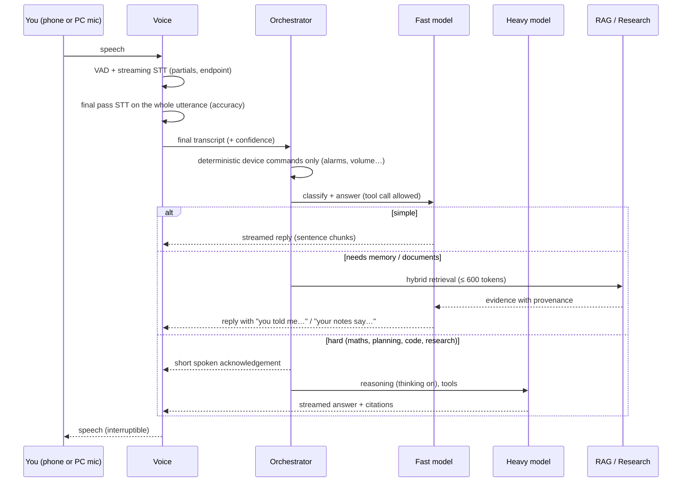

# CLU: next-generation local architecture (proposal)

_Planning document, 9 November 2026. **Nothing here is implemented.** It is based on:_

- _the repository at `f4c28d9` (tag `pre-audit-1.12`);_
- _CLU's existing design documents (`docs/AEE_*`, `SELF_REPAIR.md`, `LLM_RELIABILITY.md`, `VOICE_*`, `LIVEKIT_*`);_
- _web research carried out today (sources at the end)._

## How to read the numbers

Every figure carries a tag:

| Tag | Meaning |
|---|---|
| **(M)** | Measured in this project |
| **(S)** | Published by a source (linked) |
| **(E)** | My estimate, with the arithmetic shown |

The target PC has **not** been measured: this work ran in a cloud container, not on the PC. Milestone 0 exists to turn
every (E) into an (M) before anything is built on it.

---

## 0. The short answer

**What is realistically achievable on a Ryzen AI 7 350 with 32 GB:**

- **Conversation:** a fast local conversational CLU, with replies starting in about 1–1.5 s after you stop speaking.
- **Reasoning and coding:** a much stronger model that loads when needed. It reasons and codes at roughly the level of
  the best 30B-class open models of 2026, at about 10–20 words per second. It is not frontier level.
- **Retrieval and research:** retrieval over everything you own, and a research engine that reads several independent
  sources and tells you where they disagree.
- **Self-maintenance:** supervised, and limited to small, well-tested fixes. Larger changes stay with you.

**What is not achievable:**

- Frontier-model reasoning.
- Long autonomous coding sessions that can be trusted without review.
- Search that matches commercial assistants: Google offers no search API to new customers, and Reddit's API access is
  closing.
- Running a large model, retrieval, speech and Windows all at full speed at the same time.

**The main bottlenecks:**

1. **Memory bandwidth.** Decode speed is bound by it: about 90 GB/s on DDR5-5600 and 128 GB/s on LPDDR5X-8000 (S).
2. **Prompt processing (prefill) on the integrated GPU.** A long prompt, such as memory plus retrieved passages, may
   take longer to read than the answer takes to generate. The architecture is shaped around avoiding long prompts.
3. **32 GB shared between Windows, the GPU and the models.** A 30B-class model at 4 bits plus everything else is
   close to the limit.

**My decision, in one paragraph:**

- **Models:** keep a small fast model (about 4B) resident for conversation and tool use. Load one sparse
  mixture-of-experts model (about 35B total, about 3B active per word) on demand, for reasoning, coding and research
  synthesis.
- **Speech:** two-pass recognition, a fast streaming pass for timing and a stronger final pass for accuracy.
- **Retrieval:** the SQLite store CLU already has, plus a small embedding model.
- **Research:** a source-adapter research engine.
- **Agents:** OpenCode, run headless, as the coding worker under CLU's existing orchestrator and permission broker.
- **Not adopted:**
  - Goose as a second controller: it would duplicate CLU's own controller and permission system.
  - The NPU on the critical path, until it is measured.

---

## A. Audit of the existing architecture

### A.1 What exists

| Area | What is there (verified in the code) | State |
|---|---|---|
| Identity and core | Kotlin `core` module shared by Android and the PC host: settings registry (300 settings, each with a verifying test), conversations, people, persona, audit, sync (hybrid logical clocks, tombstones, encrypted bundles) | **Retain.** A solid foundation |
| Inference | llama.cpp through JNI (`clu_llama`), **CPU build plus an optional Vulkan build** shipped in the Windows installer (`optional/windows-x64-vulkan`); `InferenceService` (states, queue, timeouts, guard); `ResourceGovernor`; model manager and benchmark. llama.cpp source is dated **2026-10-23** (M) and supports `qwen35`, `qwen35moe`, `gemma4`, `gpt-oss`, `qwen3next`, `lfm2moe`, among others (M, `src/llama-arch.cpp`) | **Retain the engine.** Add multi-model slots. The Vulkan path on the 860M has **never been measured** |
| Default models | Catalog: Qwen2.5-3B (default), Llama-3.2-3B, Qwen2.5-1.5B. Earlier tests used SmolLM2-135M and Qwen3-0.6B | **Replace.** The models are the main cause of weak reasoning (§A.3) |
| Memory | `MemoryService`: five kinds, working memory, relations, provenance, proposals and approval; hybrid recall with reciprocal-rank fusion. An `Embedder` interface exists but **no embedding model ships** (M: `MemoryService.kt:76`). Documents use a hand-written BM25 over `document_terms` (not FTS5, which Android's SQLite doesn't guarantee) | **Retain and extend.** Add embeddings, a reranker and unified provenance |
| Search | Providers: Brave (needs a key), SearXNG (owner's URL), and keyless (DuckDuckGo instant answers plus Wikipedia). Pinned, robots-aware page reader; claim validation; GDACS and Open-Meteo for hazards | **Retain the safety layer** (pinned fetch, robots, untrusted-content handling). **Replace** the single-provider flow with a research engine |
| Agents | `AgentRole`, `Roles`, `AgentToolRegistry`, `PermissionBroker` (M7); task planner with approvals; browser control over the DevTools protocol (1.11); capability and software authoring (G1–G3) | **Retain as CLU's one controller** |
| Self-maintenance | AEE design (`AEE_ARCHITECTURE_SPEC.md`, roadmap E0–E6: Supervisor process, worktrees, gates, rollback) and a first working self-repair (`SELF_REPAIR.md`) | **Retain the design.** Plug a coding worker into it |
| Voice | LiveKit server run locally by the host; FFI room client; Silero VAD; sherpa-onnx streaming zipformer (20M) and Whisper (base/small); TTS: Kokoro, Piper, Kitten, Supertonic; barge-in and backchannels; streaming chunker with pause shaping | **Retain the transport and engines.** Change the recognition strategy (§B.5) |
| Android ↔ PC | LiveKit for audio, token service, phone access with address rebinding (1.11), Android thin-terminal mode, on-device fallback engine | **Retain.** Add discovery and an away-from-home path |
| UI | Android 1.12 and PC 0.10 redesign | Out of scope; unchanged |

### A.2 What works (evidence)

- **Automated tests:** core 702, app 96 and desktop 138/139 pass on the build host (M, 2026-11-09).
- **End-to-end on the build host:**
  - real LiveKit server, real STT/TTS and a real small model (M8.5);
  - browser control against a real Chromium (1.11);
  - PC window redesign in Chromium (0.10).
- **Not run on your hardware:** none of these, and no phone has run the current build.

### A.3 What is broken or weak: the field reports, and their likely causes

These come from your last message and an audit I started and then stopped when you changed the assignment. Each is a
**hypothesis with evidence**, still to be confirmed on the PC in Milestone 0.

| Symptom | Most likely cause | Evidence so far |
|---|---|---|
| Poor reasoning, maths, instruction following | Models of 0.6–3B parameters cannot do multi-step maths or follow layered instructions reliably, whatever the prompt | Catalog default is Qwen2.5-3B; earlier evaluations used 135M–0.6B (M). Public benchmarks put 2B-class models far below 9B and 30B-A3B (S: Artificial Analysis index 16 for Qwen3.5-2B vs 32 for 9B) |
| Intent misunderstood | A large regular-expression router (`IntentRouter`) intercepts phrasings before the model sees them, and each feature added more patterns | Many routes added in 1.9–1.11 (M); the router decides before the model (M, `CluAgent`) |
| Truncated or misheard sentences | (1) The 20M streaming zipformer is small. (2) A VAD silence endpoint cuts natural pauses. (3) The streaming result is used as the final transcript | Recognition quality depends on the test harness (`SpeechEnginesTest` dropped "Clue" under CPU load, passed when re-run alone; M, 2026-11-09) |
| TTS pauses at commas and full stops | Mid-sentence "stall flushes": when generation is slower than speech, the chunker cuts at a word boundary and each piece is spoken as a separate utterance with end-of-sentence intonation | `StreamingSpeech.stallLoop` and `AdaptiveChunker.flushIfStalled` (M, code); slow local generation makes stalls frequent |
| Search queries and results wrong | One provider at a time, keyless fallback with thin snippets, and query focusing by rules (`AgentController.focus`) | Keyless provider is DuckDuckGo instant answers plus Wikipedia (M); live testing was blocked by this container's network policy |
| Phone ↔ PC unreliable | Firewall rules, Wi-Fi client isolation, address changes (fixed in 1.11), no discovery, no away-from-home path | Your diagnostics on 2026-11-05 showed timeouts on the same subnet (M) |

### A.4 Duplicated or unnecessary components

- **Agent controllers:** three overlap. M7 roles/orchestrator, the task planner, and the AEE "Development engine"
  design. They should become **one** controller with roles; the AEE design already says so (principle 1).
- **Engine paths:** the PC host (Kotlin VoiceAgent plus LiveKit) and the phone's own on-device engine. Both are
  needed (offline fallback). The older Python LiveKit worker was already removed in M8.4, so there is nothing to
  retire.
- **Speech engines:** four TTS engines and three STT models ship. Keep one primary and one fallback for each.

---

## B. Recommended architecture

### B.1 Components

```mermaid
flowchart TB
  subgraph Phone["Android (portable interface)"]
    PUI[CLU app UI] --> PLK[LiveKit client]
    PUI --> PLocal[Offline fallback: small on-device model, local memory replica]
  end
  subgraph PC["Windows PC (CLU host: one identity)"]
    direction TB
    API[Host API + auth + task queue]
    ORCH[CLU Orchestrator<br/>one controller, roles, PermissionBroker, audit]
    ROUTE[Model router + InferenceService<br/>priorities, budgets, KV cache]
    subgraph Models["llama.cpp model slots"]
      FAST[Fast slot: ~4B dense, resident<br/>iGPU (Vulkan)]
      HEAVY[Heavy slot: ~35B-A3B MoE, on demand<br/>iGPU + CPU experts]
      EMB[Embedder ~0.6B + Reranker ~0.6B<br/>CPU]
    end
    MEM[Memory & RAG<br/>SQLite: records, chunks, BM25, vectors, provenance]
    RES[Research engine<br/>planner, source adapters, reader, claims, synthesis]
    TOOLS[Tools: MCP host + native tools<br/>files, browser, email, calendar, scripts]
    CODE[OpenCode (headless) in git worktrees]
    VOICE[Voice: VAD, 2-pass STT, endpointing, TTS, barge-in]
    LKS[LiveKit server (local)]
    SUP[CLU Supervisor (separate process)<br/>versions, health gate, rollback, kill switch]
    DIAG[Diagnostics & health checks]
  end
  PLK <-->|WebRTC audio + data| LKS
  PUI <-->|HTTPS + token| API
  LKS <--> VOICE
  VOICE --> ORCH
  API --> ORCH
  ORCH --> ROUTE --> Models
  ORCH --> MEM
  ORCH --> RES --> MEM
  ORCH --> TOOLS
  ORCH --> CODE
  MEM --> EMB
  RES --> EMB
  DIAG --> ORCH
  SUP -.watches.-> PC
```

**Principles:**

- **One controller.** The Orchestrator owns intent, memory, permissions and the audit log. Models, OpenCode and tools
  are workers it calls. Nothing else can act on its own.
- **One model server per model, not one per feature.** Every feature asks the router for "fast" or "heavy", never for
  a specific file.
- **Short prompts by construction.** Prompts carry a cached system prefix, a rolling conversation summary and at most
  about 600 tokens of retrieved evidence, because prefill is the bottleneck (§D).

### B.2 Data flow of one spoken turn



### B.3 Model routing

Routing is a two-step decision. Rules never answer questions.

1. **Deterministic layer, kept small:** only commands with exact, safe semantics, such as alarms, timers, volume,
   "stop", app launching and confirmations. Everything else goes to the model. This retires most of the current
   `IntentRouter` patterns.
2. **The fast model decides** in its first tool call (structured output, grammar-constrained by llama.cpp's GBNF/JSON
   schema), choosing one of:
   - `answer`;
   - `use_tool(...)`;
   - `retrieve(scope)`;
   - `research(question)`;
   - `escalate(reason)`.

**Escalation triggers:**

- the fast model chooses `escalate`;
- arithmetic or multi-step maths is detected (the expression is also checked by a calculator tool: never trust model
  arithmetic);
- code or repository work;
- research synthesis;
- you ask for it ("think carefully").

**Rules for the heavy model:**

- **Thinking mode is set per request.** Qwen-family models toggle it. It is off for synthesis, and on for maths,
  planning and code.
- **The fast model never pretends to be the heavy one.** If the heavy model can't load (memory, a busy GPU), CLU says
  so and offers to do it later or answers from the fast model with a stated caveat.

### B.4 Memory and RAG

**One store, three provenances.** Every retrievable item carries:

- `origin`: one of `you_told_me` (owner statement or approved memory), `your_files` (documents, notes, diary),
  `conversation`, `research` (fetched from the web, with URL and retrieval date) or `system`;
- trust and time.

The prompt renders provenance explicitly: *"[You told me, 3 Oct] …"* versus *"[Retrieved from bbc.co.uk on 9 Nov]
…"*. Research results are stored as research and are never promoted into "you told me" without your approval. This
reuses the existing proposal and approval flow.

**Retrieval pipeline:**

1. Query rewriting by the fast model, used only when the turn is a follow-up ("what about her sister?").
2. Hybrid candidates:
   - BM25 (the existing term index; FTS5 may be used on the PC);
   - dense vectors;
   - metadata filters (origin, person, date, project, document).
3. Reciprocal-rank fusion (already implemented).
4. Rerank the top 30–50 with a cross-encoder of about 0.6B.
5. MMR for diversity; duplicates removed.
6. **Context compression:** extractive sentence selection, not generative summary, to at most about 600 tokens.
7. Citations carried through to the answer.

**Technology decision:**

| Option | For | Against | Decision |
|---|---|---|---|
| **Vectors as int8 BLOBs in SQLite, exact cosine in the JVM** | No native extension; works the same on Android and the PC; the existing schema already stores BLOB embeddings (voiceprints) | Linear scan. 100k chunks × 1024 dims int8 is about 100 MB and roughly tens of ms per query (E: 100M multiply-adds) | **Use first.** It meets the needs of a personal corpus (≤ 200k chunks) |
| sqlite-vec | SQL-native KNN, mature hybrid patterns (S) | A native extension in two runtimes (Android framework SQLite cannot load extensions; JDBC can); version 0.1.x (S) | Re-evaluate past about 200k chunks, on the PC only |
| SQLite `vec1` | Merged into the SQLite source tree in September 2026 (S, one secondary report) | No release, API or performance published | Watch |
| FAISS / external vector DB | Fast ANN | Another process and runtime; unnecessary at personal scale | Reject |

**Embeddings and reranking:**

| Model | Size | For | Against | Decision |
|---|---|---|---|---|
| **Qwen3-Embedding-0.6B** (GGUF, llama.cpp `--embedding`) | Q8 ≈ 0.64 GB (S) | Strong quality, 32K context, adjustable dimensions, runs in CLU's existing llama.cpp | Large KV at long context (S): cap the input at 512–1024 tokens per chunk | **Primary** |
| EmbeddingGemma (300M; v2 reportedly stronger) | ≈ 0.3–0.5 GB | Lighter; could run on the phone | Shorter context; code retrieval weaker in v1 (S) | Phone-side option |
| bge-m3 | ≈ 0.6 GB | Multilingual (Hindi), dense plus sparse | An extra runtime unless converted | Fallback if Hindi recall is poor |
| Reranker: Qwen3-Reranker-0.6B or bge-reranker-v2-m3 | ≈ 0.6 GB | Large precision gain on top-k | About 30–80 ms per 30 pairs on CPU (E) | Load with the heavy model, or on demand |

**Indexing:**

- Incremental, by content hash.
- A background worker at the lowest priority that pauses whenever a voice turn or interactive request runs.
- Chunks of 300–500 tokens with 15 % overlap, following headings (Markdown, PDF outline).
- Near-duplicates detected by cosine above 0.95 within the same origin.
- The PC indexes; the phone receives only the records it needs (or queries the PC).

### B.5 Research engine (source-agnostic)

**Stages:**

1. **Understand.** The fast model produces a typed research plan: the question type (fact, current event, product,
   opinion or review, technical, academic, local), the entities, the time sensitivity, and which *kinds* of evidence
   would answer it.
2. **Expand.** Two to four queries, including the full entity name. "Warhammer 40,000" stays one entity; entity
   spans come from the plan, not from stop-word stripping.
3. **Fetch in parallel** from the source adapters relevant to the type, each with its own rate limit, timeout and
   budget (default: 6 sources, 12 pages, 20 s).
4. **Read:** the existing pinned fetcher, robots rules and untrusted-content isolation, then boilerplate removal.
5. **Chunk, embed and rerank** against the question.
6. **Claims.** The heavy model extracts claims with stance, labelled fact / opinion / speculation, the source and a
   quote.
7. **Cross-check.** Cluster equivalent claims; flag contradictions; weigh sources by type and independence (ten
   reposts of one press release count once).
8. **Synthesise.** Answer with citations, an explicit "sources disagree" section where they do, and the uncertainty
   stated.
9. **Store** the research record (origin `research`) for later recall.

**Source adapters: what is actually available without paying (2026):**

| Source | Access | Notes |
|---|---|---|
| Brave Search API | Free monthly credit (reported $5, about 1,000 queries), then paid (S) | Best general web API for an individual; owner's key, optional |
| SearXNG (self-hosted) | Free; aggregates other engines | Not a native Windows program: needs WSL2/Docker, or the uv-based SimpleXNG (S). Engines that scrape Google or Bing may be blocked or captcha'd: best effort, **optional sidecar** |
| Google Programmable Search | **Closed to new customers; shuts down 1 January 2027** (S) | Not viable |
| Wikipedia / Wikidata APIs | Free | Encyclopaedic baseline (already used) |
| DuckDuckGo instant answers | Free, unofficial for full results | Instant answers only; already used |
| Reddit | OAuth free tier for non-commercial use reported at 100 QPM, but **new access reportedly needs approval and is being wound down** (S, conflicting) | Treat as optional and fragile. Use Reddit threads only via search results unless you obtain a key |
| YouTube Data API | Free quota (10,000 units/day; a search costs 100) (E, from public docs) | Metadata, statistics and comments. Third-party captions aren't available through the official API |
| OMDb / TMDB | Free keys (non-commercial) | Film ratings: IMDb, Rotten Tomatoes and Metacritic via OMDb; release data via TMDB |
| arXiv, OpenAlex, Semantic Scholar, Crossref, PubMed | Free APIs | Academic research |
| Stack Exchange, GitHub, Hacker News (Algolia) | Free APIs (keys raise quotas) | Technical questions |
| GDELT and official RSS | Free | News |
| Government and official sites | Fetch with robots rules | Located through web search |

**Example: "Is this film good?"** The plan type is `opinion/review`. The engine then:

- pulls critic aggregates (OMDb: Rotten Tomatoes and Metacritic) and audience ratings (IMDb via OMDb);
- reads review text from two or three critic pages found by search;
- reads community discussion (Reddit if a key is present, otherwise threads found through web search);
- uses box office from Wikipedia;
- reports *"critics 92 %, audiences 61 %: the disagreement is about …"* with quotes.

Nothing about films is hard-coded beyond which adapter families suit a review question.

**How much runs locally:**

- **Local:** everything except the network calls, including planning, reading, embedding, reranking and synthesis.
- **Time:** a research answer takes 15–60 s on this hardware (E: 12 pages × reading plus about 1,500 tokens of
  synthesis at about 15 tok/s). That is acceptable for research, with spoken progress, but it is not a conversational
  path.

### B.6 Agents: Goose, OpenCode and CLU

| | Goose (AAIF / Linux Foundation; formerly Block) | OpenCode (MIT; anomalyco/opencode) |
|---|---|---|
| What it is | General desktop agent; tools are MCP "extensions"; providers include Ollama, OpenAI-compatible endpoints, a llama.cpp local provider (S) | Coding agent; `opencode serve` gives a headless HTTP server with an OpenAPI spec, basic auth and `run --attach` (S); local models through an OpenAI-compatible baseURL (S) |
| Fit with CLU | Overlaps CLU's orchestrator, permissions, memory and UI: a **second brain with its own permission model** | A worker CLU can call for one job (edit and test a repository) inside a worktree CLU controls |
| Local-model quality dependence | High: tool-heavy loops with a 3B-active model are fragile | High, but coding tasks have objective checks (build, tests) |

**Decision:**

- **OpenCode as the coding worker.** It is started by CLU in a dedicated git worktree, pointed at CLU's own
  OpenAI-compatible endpoint (llama.cpp server for the heavy slot), and given a task, a budget and a test command. CLU
  reviews the diff and the test results and asks you before merging.
- **Not Goose as the primary agent.** CLU already has the controller, the PermissionBroker, the audit log and the
  memory. Adding Goose would create two of each.
- **MCP as CLU's tool protocol.** CLU becomes an MCP **host**, so it can use MCP servers such as filesystem, IMAP
  email or calendar. CLU also exposes its own tools as an MCP **server**, so OpenCode (or Goose, if you ever want it)
  can call CLU's memory and permissions. That keeps Goose a possible later front-end without making it the brain.
- **Android requests tasks** through the host API task queue (already present). Tasks continue when the phone
  disconnects, and their results and notifications sync back.

### B.7 Supervised self-maintenance

Keep the AEE design (already in the repo) and fill in its executor.

**Loop:**

1. **Observe:** health checks, logs, diagnostics, failed tests.
2. **Diagnose:** the heavy model with retrieval over CLU's own code index (`code` origin in RAG).
3. **Hypothesise:** a recorded hypothesis.
4. **Patch:** OpenCode in a fresh worktree.
5. **Verify:** build, unit tests, the relevant acceptance suite, and the evaluation suite (§D.4).
6. **Gate:** the Supervisor, a separate process outside the AEE's write scope.
7. **Approve:** you approve, through the phone or the PC.
8. **Activate:** in a new version slot.
9. **Watch and roll back:** watch with automatic rollback on a failed health gate.

**Rules, carried from your brief and the AEE spec:**

- No change without a git checkpoint and a worktree.
- Tests are reported as run or not run, never assumed.
- Mocked tests are never labelled device verification.
- Dangerous operations always need approval: deleting data, network or credential changes, system files, installers.
- Every step goes into the audit log.

**Honest capability:**

- **Can do:** a local 30B-A3B-class model can fix small, localised bugs when a failing test pins them down. Expect
  that, not architecture changes.
- **Cannot do:** larger changes stay human-approved proposals.
- **Optional:** free-tier external models can be configured as a "second opinion", but they are never required.

### B.8 Voice architecture

| Stage | Choice | Why | Alternative |
|---|---|---|---|
| Transport | Keep LiveKit (local server) between the phone/PC microphone and the host | Works today; WebRTC handles jitter and echo; LiveKit does not supply the engines, CLU does | Raw WebSocket audio: more work, no benefit |
| VAD | Silero (existing) | Proven | — |
| Streaming STT (partials, timing) | Existing sherpa-onnx streaming zipformer, or NVIDIA's streaming Nemotron/Parakeet model if available in sherpa-onnx | Only drives live captions and endpoint timing | — |
| **Final STT (accuracy)** | **Second pass over the whole utterance:** Parakeet TDT 0.6B v3 int8 (sherpa-onnx) for English and European languages; Whisper small for Hindi | Parakeet v3 runs at about 30× real time on a desktop CPU (S: RTF ≈ 0.054 on an i7-12700KF), so a 5 s utterance takes about 0.2–0.3 s (E). The partial transcript is **never** used as the final | Whisper small/turbo for everything: slower (about 1–2 s per utterance on CPU, E) |
| Endpointing | VAD silence (adaptive: longer after "and", "but", "um" or a rising pitch) plus an optional semantic end-of-turn model | Prevents cutting off mid-thought | LiveKit's turn-detector model: Qwen2.5-0.5B-based, ≈ 400 MB, CPU (S), but under the **LiveKit Model License**, not a standard open-source licence: review it before adopting |
| TTS | Kokoro primary, Piper fallback (existing) | Quality versus speed | Kitten / Supertonic: keep out of the default set |
| Chunking | **Sentence-level chunks only**; never stall-flush mid-sentence. If generation is slower than speech, CLU waits up to about 600 ms at a clause boundary rather than cutting a phrase in two | Fixes the comma and full-stop prosody (§A.3) | — |
| Interruption | Keep barge-in and backchannel rules (1.11); cancel the generation, the TTS queue and the LiveKit track together | Exists | — |
| CPU reservation | Pin STT and TTS to 2 of the 8 cores; models use the iGPU plus the remaining cores | Avoids contention while the heavy model runs | — |

**Latency budget for a fast-tier spoken turn (E):**

| Stage | Time |
|---|---|
| Endpoint | 300–500 ms of silence |
| Final STT | ≈ 250 ms |
| Fast-model time to first token, cached prefix plus ≤ 150 new tokens | 300–600 ms |
| First TTS chunk | 150–250 ms |
| **Total, speech end to first audio** | **≈ 1.0–1.6 s** |

### B.9 Android and PC

**One identity and one memory:** the PC is authoritative. The phone keeps an encrypted replica through the existing
sync (HLC and tombstones) and works offline with its small model.

**Connection:**

- **Discovery:** mDNS/NSD advertisement by the host, instead of typing IP addresses.
- **Transport:** keep LiveKit for audio and HTTPS with a token for control.
- **Away from home:** an optional **WireGuard/Tailscale** personal network, free for personal use. LiveKit and the
  API then work unchanged over the tunnel.
- **Firewall:** the installer creates scoped firewall rules (private profile only) instead of leaving them to you.

**Continuity:**

- Tasks run on the PC and survive phone disconnects.
- The phone receives results through sync or push when it reconnects.
- When the PC is unreachable, the phone says so and answers locally, labelled "on this phone".

---

## C. Technology comparison (models)

### C.1 Hardware facts (published) and what must be measured

| Item | Published (S) | Must verify on the PC |
|---|---|---|
| CPU | Ryzen AI 7 350, 8 cores / 16 threads (Zen 5 + Zen 5c) | Core types, power plan, sustained clocks under load |
| Memory | LPDDR5X-8000 (128 GB/s) **or** DDR5-5600 (89.6 GB/s), depending on the laptop or mini-PC | **Which one you have.** It changes every speed estimate by about 40 % |
| iGPU | Radeon 860M, 8 CUs (RDNA 3.5) | Vulkan driver version; how much memory Windows lets the iGPU map ("shared GPU memory", usually 50 % of RAM, plus any BIOS UMA reservation) |
| NPU | XDNA 2, up to 50 TOPS | Driver; whether FastFlowLM/Lemonade runs; its measured tokens per second |
| ROCm / CUDA / DirectML | CUDA: no (not NVIDIA). ROCm: unofficial at best for this iGPU; reports of MoE HIP kernel issues through early 2026 (S) | Don't plan on ROCm. Vulkan is the GPU path |

### C.2 Speed estimates (to be replaced by measurements)

Decode speed is limited by bytes read per token. Calibration: Llama-3.2-1B Q4_K_M (≈ 0.8 GB) generates about
50 tok/s on this exact iGPU (S, LocalScore), which implies about 40 GB/s effective. A Qwen3-4B on this exact CPU's NPU
(FastFlowLM) decodes at 14.3 tok/s at short context and 6.3 tok/s at 32K (S). I use 40–60 GB/s effective for the
iGPU.

| Model (Q4-class) | Bytes read per token | Decode (E) | Use |
|---|---|---|---|
| Qwen3.5-2B | ≈ 1.3 GB | 30–45 tok/s | Tiny router / phone |
| **Qwen3.5-4B** | ≈ 2.6 GB | **15–23 tok/s** | **Fast tier** |
| Gemma 4 E4B | ≈ 2.5–3 GB | 13–22 tok/s | Fast-tier alternative |
| Qwen3.5-9B | ≈ 5.6 GB | 7–11 tok/s | Too slow for conversation; acceptable for synthesis |
| **Qwen3.6-35B-A3B (MoE, 3B active)** | ≈ 2–2.5 GB active of ≈ 17–21 GB | **12–20 tok/s** | **Heavy tier**: reasoning, code, research |
| gpt-oss-20b (MoE, 3.6B active, MXFP4 ≈ 12–13 GB) | ≈ 2–2.5 GB active | 12–20 tok/s | Heavy-tier alternative that fits more easily |
| Gemma 4 26B-A4B (MoE, 4B active) | ≈ 2.5–3 GB active | 10–18 tok/s | Heavy alternative |
| Qwen3.6-27B / Gemma 4 31B (dense) | ≈ 16–19 GB | 2–4 tok/s | **Rejected**: too slow here despite the quality |

**Prefill (reading the prompt)** is the unknown that matters most. A reported 192 tok/s for a 1B model on this iGPU
(S) would mean about 40–80 tok/s for a 4B. If confirmed, a 2,000-token prompt would take 25–50 s. That is why the
design keeps:

- a **cached system prefix** (CLU already orders the prompt for prefix caching);
- **conversation KV reuse** across turns;
- **≤ 600 tokens of retrieved context**.

Milestone 0 measures this first. If prefill is much better, as llama.cpp Vulkan generally is on RDNA, the budgets can
grow.

### C.3 Candidate models (state of November 2026, from sources)

| Family | Sizes relevant here | Strengths | Concerns |
|---|---|---|---|
| **Qwen3.5** (February 2026, Apache-2.0) | 0.8B, 2B, 4B, 9B dense; 35B-A3B MoE; larger ones too big (S) | Hybrid thinking/non-thinking modes; native tool calling; strong small models (9B reportedly beats far larger older models) (S) | 4B and 9B weaker on hard reasoning and coding than the MoE (S) |
| **Qwen3.6** (April 2026, Apache-2.0) | 27B dense, 35B-A3B MoE (S) | Newest Qwen generation available as open weights; the 35B-A3B is widely used for local agentic coding (S) | 17–21 GB at 4 bits: memory pressure on 32 GB |
| **Qwen3-Coder-30B-A3B** | 30B-A3B | Specialised coder; the default local coding model in several 2026 guides (S) | Overlaps the general MoE; guides disagree on which wins (S). Only add it if CLU's own coding evaluation shows a gap |
| **Gemma 4** (March–June 2026, Apache-2.0) | E2B, E4B, 12B, 26B-A4B, 31B (S) | Edge models (E2B/E4B) suit the phone; 26B-A4B is an alternative heavy model | Tool-calling reliability unmeasured for CLU's format |
| **gpt-oss-20b** (Apache-2.0) | 21B MoE, about 3.6B active, MXFP4 ≈ 12–13 GB (S) | Fits easily next to the fast model; strong reasoning per byte; AMD documents NPU acceleration work for it (S) | Narrower world knowledge than the Qwen MoE; its "harmony" chat format must be handled; reasoning-only style |
| DeepSeek V4.x, Kimi K3, Qwen 397B, etc. | ≥ 100B | Frontier-class open weights (S) | **Cannot run on 32 GB**: not considered |
| Llama 4 | 109B+ | — | Too large; Llama 3.x small models are now weaker than Qwen3.5 and Gemma 4 at equal size |

Some secondary sources mention "Qwen3.8-27B" and other names I could not confirm on official pages. They are left out
until verified on the official Hugging Face organisations.

### C.4 Can the models coexist in memory? (E)

| Resident component | Memory |
|---|---|
| Windows 11 + browser + usual apps | 7–9 GB |
| CLU host (JVM), LiveKit server, PC window (Edge) | 1.2–1.8 GB |
| Voice: VAD + streaming STT (≈ 0.1 GB) + Parakeet final pass (≈ 0.7 GB) + Kokoro (≈ 0.35 GB) | ≈ 1.2 GB |
| Embedder (Qwen3-Embedding-0.6B Q8, short context) | ≈ 0.8 GB |
| Fast model Qwen3.5-4B Q4_K_M + 8K KV cache | ≈ 3.2–3.6 GB |
| **Subtotal, always resident** | **≈ 13.5–16 GB** |
| Heavy option A: Qwen3.6-35B-A3B IQ4_XS (≈ 17–18 GB) + 16K KV | ≈ 19 GB |
| Heavy option B: gpt-oss-20b MXFP4 (≈ 13 GB) + 16K KV | ≈ 14 GB |
| Reranker (loaded with the heavy model) | ≈ 0.7 GB |

**Results:**

- **Option B coexists:** about 28–31 GB in total. Tight but workable.
- **Option A does not coexist safely:** about 33–36 GB in total, which forces Windows to page.

So:

- **Option A heavy (Qwen3.6-35B-A3B):** load on demand, and only after the governor has freed what it can.
  - Unload the reranker and any idle voice engine.
  - Use llama.cpp's `--n-cpu-moe` so the experts stay in system RAM (memory-mapped) and only the attention and shared
    weights go to the iGPU. That avoids the iGPU's shared-memory ceiling.
  - Unload after about 5 idle minutes.
- **Option B heavy (gpt-oss-20b):** can stay warm while you work.
- **Selection:** made **by measurement in Milestone 0**, using quality on CLU's own evaluation set, speed, and the
  Windows responsiveness test (§D.3). A measured "B everywhere" is better than a theoretical "A".

Loading cost from NVMe: about 3–6 s for 13–18 GB on a cold cache (E: 3–5 GB/s), and under 1 s when the file is still
in the OS page cache. The spoken acknowledgement covers it.

### C.5 The NPU

**Evidence:**

- FastFlowLM, now under the ROCm organisation on GitHub (S), runs Qwen3/3.5 models on XDNA 2, including this exact CPU.
  It publishes 14.3 tok/s decode for Qwen3-4B (S) and has builds of Qwen3.5-4B and Qwen3.6-35B-A3B (S).
- An independent test found the NPU **slower than the iGPU** for gpt-oss-20b (9.5 tok/s) (S).
- AMD has published work on MoE acceleration on the NPU (S).
- The licence for FastFlowLM's binary kernels is reported differently by different sources: non-commercial only, free
  under a revenue cap, or free (S). **This must be read from the official repository** before relying on it.

**Decision:**

- **Not on the critical path.** In Milestone 0, measure the fast model on the NPU. If it reaches the iGPU's speed
  within about 20 %, move the fast tier to the NPU. That frees the iGPU entirely for the heavy model and removes the
  main contention. This is the most valuable possible use of the NPU.
- **Otherwise:** use the NPU for background embedding of large imports, if supported, or not at all.

---

## D. Performance strategy

### D.1 Latency targets (to be validated in Milestone 0)

| Path | Target |
|---|---|
| Spoken fast-tier turn: speech end → first audio | ≤ 1.5 s (p50), ≤ 2.5 s (p90) |
| Typed fast-tier turn: send → first token | ≤ 0.8 s |
| Memory-grounded answer (retrieval + fast model) | ≤ 2.5 s to first audio |
| Heavy-tier answer | Spoken acknowledgement ≤ 1 s; first content ≤ 6 s with a warm model, ≤ 12 s cold |
| Research answer | Spoken progress every ≤ 8 s; complete in 15–60 s |
| Stop / barge-in | Silence ≤ 200 ms |
| Windows responsiveness while the heavy model runs | UI frame drops < 5 %; a typed character in another app appears ≤ 50 ms |

### D.2 Concurrency and priorities

There is one arbiter, the existing `InferenceService` queue extended to several slots, with these priorities:

1. barge-in and stop;
2. the voice turn;
3. the interactive typed turn;
4. agent steps;
5. research;
6. background indexing and maintenance.

**Rules:**

- Background work pauses the moment the microphone opens and resumes after 10 s of quiet.
- The heavy model never preempts the fast model's GPU work in the middle of a token batch: it uses a separate
  llama.cpp context, and the governor caps the heavy model's threads.
- STT and TTS keep 2 reserved cores.
- When system free memory falls below 3 GB, the governor (already present) unloads in this order: reranker, heavy
  model, final-pass STT (falling back to the streaming result, flagged in diagnostics). It never unloads the fast model
  during a conversation.

### D.3 Model loading

| Component | Lifetime |
|---|---|
| Fast model, embedder, VAD, STT, TTS | Resident while CLU runs |
| Heavy model | On demand. It stays warm while used, unloads after 5 idle minutes (a setting), and the governor unloads it on memory pressure |
| Reranker | Loaded with the heavy model, or on demand for retrieval-heavy turns |
| OpenCode | Started per task, stopped after it finishes |

**Process layout:**

- **Fast slot:** stays in CLU's own JNI engine, which is lowest-latency and already integrated.
- **Heavy slot:** runs as a separate `llama-server` process. That gives OpenCode an OpenAI-compatible endpoint, keeps
  a crash or out-of-memory away from the host, and lets the OS reclaim the memory completely on unload.

### D.4 How quality is measured (prevents "tests pass but it doesn't work")

A fixed **evaluation set**, run on the PC on every model or prompt change:

| Category | Contents |
|---|---|
| Maths | 120 problems with exact answers |
| Instruction following | 80 cases, constraint-checked |
| Tool-call accuracy | 100 utterances with gold tool calls |
| Retrieval grounding | 60 questions over a fixed personal fixture |
| Research | 30 questions with known answers and sources, judged on citation correctness |
| Spoken-turn regressions | 40 recorded utterances, including your reported failures, through the real voice pipeline |

Results are stored with the model, quantisation and commit. **A change ships only if the evaluation does not regress.**
The scores are reported as numbers, not as "passes".

---

## E. Roadmap

Each milestone ends with measured acceptance criteria on the real PC, or on the phone where stated, and a rollback.

| # | Milestone | Depends on | Acceptance (measured) | Rollback |
|---|---|---|---|---|
| **M0** | **Hardware verification and benchmarks.** SystemProbe report (RAM type and speed, iGPU shared-memory limit, Vulkan driver, NPU driver); `llama-bench` CPU vs Vulkan for Qwen3.5-4B, Qwen3.6-35B-A3B (with `--n-cpu-moe`), gpt-oss-20b, Gemma 4 E4B and 26B-A4B (prefill and decode at 512/2K/8K); STT/TTS real-time factors; NPU trial (FastFlowLM, after the licence check); first evaluation-set run | — | A table of (M) numbers replacing §C.2; fast and heavy models chosen | Nothing changes in CLU |
| M1 | **Inference platform.** Multi-slot router; heavy `llama-server` sidecar; per-request thinking control; GBNF tool calls; governor integration; diagnostics show which model answered and why | M0 | Fast-turn latency targets met; heavy load/unload without UI freeze; out-of-memory test recovers | Feature flag back to the single-model path; the previous model stays registered |
| M2 | **Voice accuracy.** Two-pass STT, adaptive endpointing, sentence-only TTS chunking, 40 recorded regression utterances (yours included) | M0 | Word error rate on the set better than today; no mid-sentence TTS cuts; barge-in ≤ 200 ms (PC and phone) | Settings switch back to the current recogniser and chunker |
| M3 | **Understanding.** Shrink `IntentRouter` to safe device commands; model-based routing with escalation; a calculator tool for arithmetic | M1 | Tool-call accuracy and instruction scores improve on the evaluation set; no device-command regressions | Router kept behind a flag for one release |
| M4 | **RAG foundation.** Embeddings, vector table, hybrid plus reranking, provenance rendering, incremental indexer | M1 | Retrieval-grounding score; "you told me" vs "retrieved" correct in 100 % of fixture answers; indexing never delays a voice turn (measured) | The new index is additive; the old recall stays as a fallback |
| M5 | **Research engine v2.** Planner, adapters (Brave key, Wikipedia, OMDb/TMDB, academic, Stack Exchange/GitHub/HN, news), claims, contradictions, citations; SearXNG optional | M4 | Research set: correct answer with correct citations ≥ target; distinct, honest messages for no network / provider failure / no results / parse failure | Old single-provider search behind a flag |
| M6 | **Tools and coding worker.** MCP host and server; OpenCode headless in worktrees; email (IMAP, read-only first); file organisation with approval | M1, M4 | 20 scripted tasks completed with the expected effects; every action audited; denied actions never executed | Disable the MCP host and OpenCode with one switch |
| M7 | **Supervised self-maintenance (AEE E2/E3).** Supervisor process, version slots, gates, OpenCode as executor, health checks | M6 | Seeded-bug drills: fixes proposed with passing tests, an unhealthy deployment rolled back automatically, nothing activated without approval | Supervisor keeps the last-good slot; kill switch |
| M8 | **Android ↔ PC continuity.** mDNS discovery, firewall rules in the installer, optional WireGuard/Tailscale, task continuity | M1 | Phone reconnects within 15 s after Wi-Fi and IP changes; works over the tunnel; offline fallback labelled (real devices) | Manual address entry stays |

**Order rationale:**

- **M0** prevents building on guesses.
- **M1–M3** fix what you notice every day: intelligence, voice, understanding.
- **M4–M5** add the memory and research depth.
- **M6–M7** add autonomy, only after the base is reliable and measurable.
- **M8** can run in parallel after M1.

**Global safety:**

- Every milestone is a branch with git tags.
- Databases are backed up and verified before any migration (existing).
- Models stay registered when the default changes.
- Every new behaviour has a switch for one release.

---

## F. What I would build for myself on this PC

1. **Measure first (M0).** The memory type and the iGPU's prefill speed decide everything; a week of measurement saves
   months.
2. **Two models, not five.**
   - A **4B fast model** (Qwen3.5-4B unless Gemma 4 E4B measures better on tool calls), always loaded, on the iGPU, or
     on the NPU if M0 shows it is close in speed.
   - **One sparse MoE heavy model** used for reasoning, coding and research. **gpt-oss-20b if memory is tight** (it can
     stay warm). **Qwen3.6-35B-A3B if M0 shows it fits** with expert offload and the PC stays responsive, because it
     is stronger at coding and knowledge.
   - No separate coding model unless the evaluation proves a gap.
   - No dense 27–31B model: the quality is real, but at 2–4 tok/s it would make CLU feel broken.
3. **Make speech accurate before making it clever.** The two-pass recognition and sentence-level TTS will change how
   CLU feels more than any model upgrade.
4. **Stop routing by regular expression.** Keep a short list of exact device commands and let the model decide the
   rest, with structured tool calls and a calculator for arithmetic.
5. **RAG inside the store CLU already has.** SQLite, int8 vectors, BM25, a small reranker, strict provenance. No
   vector database server.
6. **A research engine built on free APIs with your own keys.** Brave's free credit, OMDb and TMDB, academic and
   technical APIs, Wikipedia. Reddit only if you get a key. SearXNG as an optional extra. Accept that general web
   search without Google is weaker, and make CLU say so when coverage is thin.
7. **One controller.**
   - CLU's orchestrator, with MCP for tools.
   - OpenCode as the hands for code, in disposable worktrees.
   - The AEE Supervisor as the judge.
   - Goose stays an optional front-end, not the brain.
8. **Phone as a window onto the PC.** Discovery plus a personal WireGuard/Tailscale tunnel, so the phone keeps reaching
   the PC away from home without anything paid.

**What you get:**

- An assistant that converses quickly.
- Real reasoning when it matters, at about 15 words per second.
- Knowledge of what you have told it and what it has read, kept apart.
- Research across many sources, with disagreements stated.
- Small, reviewed repairs to its own code, with checkpoints and rollback.

It will not match a frontier cloud model's reasoning; the gap is narrowest on tasks where retrieval and tools supply
the knowledge.

---

## Appendix 1: verification commands for Milestone 0 (to run on the PC)

```powershell
# Memory type and speed (LPDDR5X-8000 vs DDR5-5600 matters by ~40 %)
Get-CimInstance Win32_PhysicalMemory | Select-Object Manufacturer, PartNumber, Speed, ConfiguredClockSpeed, Capacity, SMBIOSMemoryType
# GPU, driver, and how much memory Windows lets it share
Get-CimInstance Win32_VideoController | Select-Object Name, DriverVersion, AdapterRAM
dxdiag /t $env:TEMP\dxdiag.txt   # "Shared Memory" line
vulkaninfo --summary              # from the Vulkan runtime (installed with the AMD driver) or the LunarG SDK
# NPU present and driver
Get-PnpDevice | Where-Object { $_.FriendlyName -match "NPU|IPU|XDNA" }
# llama.cpp: CPU vs Vulkan, prefill and decode at three prompt lengths
llama-bench -m Qwen3.5-4B-Q4_K_M.gguf -p 512,2048,8192 -n 128 -ngl 0,99
llama-bench -m Qwen3.6-35B-A3B-IQ4_XS.gguf -p 512,2048 -n 128 -ngl 99 --n-cpu-moe 99
```

The CLU host's `SystemProbe` already reads part of this. In M0 it would record the full set into Diagnostics, so the
numbers come from CLU itself.

## Appendix 2: sources

**Models:**
- Qwen3.5 family: [morphllm](https://www.morphllm.com/qwen-3-5), [Wikipedia: Qwen](https://en.wikipedia.org/wiki/Qwen),
  [Artificial Analysis (small models)](https://artificialanalysis.ai/ja/articles/qwen3-5-small-models)
- Qwen3.6: [unsloth Qwen3.6-27B GGUF](https://huggingface.co/unsloth/Qwen3.6-27B-GGUF),
  [APIYI release note](https://docs.apiyi.com/en/news/qwen-3-6-opensource-launch)
- Gemma 4: [model card](https://ai.google.dev/gemma/docs/core/model_card_4),
  [Google blog](https://blog.google/innovation-and-ai/technology/developers-tools/gemma-4/)
- gpt-oss on AMD: [AMD: GPT-OSS-20B on Ryzen AI NPUs](https://www.amd.com/en/developer/resources/technical-articles/2026/accelerating-gpt-oss-20b-on-amd-ryzen-ai-npus.html),
  [AMD blog](https://www.amd.com/en/blogs/2025/how-to-run-openai-gpt-oss-20b-120b-models-on-amd-ryzen-ai-radeon.html),
  [Phoronix ROCm vs Vulkan](https://www.phoronix.com/review/amd-rocm-7-strix-halo/3)
- Coding models: [Kilo: local coding models](https://blog.kilo.ai/p/the-best-local-coding-models-for),
  [Qwen3.6-35B-A3B agentic coding](https://codex.danielvaughan.com/2026/04/16/qwen36-35b-a3b-local-agentic-coding-breakthrough/)

**Hardware and inference:**
- Ryzen AI 7 350 specs: [AMD](https://www.amd.com/en/products/processors/laptop/ryzen/ai-300-series/amd-ryzen-ai-7-350.html),
  [cpu-monkey](https://www.cpu-monkey.com/en/cpu-amd_ryzen_ai_7_350)
- 860M llama.cpp data: [LocalScore 860M](https://www.localscore.ai/accelerator/1414),
  [llama.cpp discussion #21112](https://github.com/ggml-org/llama.cpp/discussions/21112),
  [Vulkan performance discussion](https://github.com/ggml-org/llama.cpp/discussions/10879)
- NPU: [Lemonade](https://developer.amd.com/playbooks/lemonade-getting-started/),
  [FastFlowLM](https://github.com/FastFlowLM/FastFlowLM),
  [FastFlowLM Qwen3 benchmarks](https://fastflow-page.pages.dev/docs/benchmarks/qwen3_results),
  [XDA NPU test](https://www.xda-developers.com/my-laptops-npu-sat-unused-for-a-year-until-found-the-local-ai-apps-that-actually-use-it/),
  [Qwen3.6-35B-A3B NPU2](https://huggingface.co/FastFlowLM/Qwen3.6-35B-A3B-NPU2)

**Retrieval:**
- Embeddings: [EmbeddingGemma 2 vs Qwen3-Embedding](https://regolo.ai/embeddinggemma-2-vs-qwen3-embedding-benchmarks.md),
  [InsiderLLM embedding guide](https://insiderllm.com/guides/embedding-models-rag/)
- SQLite vectors: [Simon Willison: hybrid search](https://feeds.simonwillison.net/2024/Oct/4/hybrid-full-text-search-and-vector-search-with-sqlite),
  [SQLite vec1 report](https://book.st-hakky.com/news/sqlite-vec1-vector-search-extension),
  [sqlite-vec gem](https://rubygems.org/gems/sqlite-vec?locale=ja)

**Search APIs:**
- [Google Custom Search shutdown](https://www.firecrawl.dev/blog/google-search-json-api-alternative),
  [Brave Search](https://en.wikipedia.org/wiki/Brave_Search),
  [Reddit API 2026](https://www.socialcrawl.dev/blog/reddit-api-key-limits-alternatives-2026),
  [SearXNG on Windows](https://www.ssdnodes.com/learn/can-you-run-searxng-on-windows),
  [SimpleXNG](https://pypi.org/project/simplexng/)

**Agents:**
- [Goose providers](https://goose-docs.ai/docs/getting-started/providers),
  [Goose MCP architecture](https://codex.danielvaughan.com/2026/04/07/goose-mcp-native-architecture/),
  [Goose offline (AAIF)](https://aaif.io/blog/running-goose-fully-offline-on-a-dgx-spark),
  [OpenCode server](https://opencode.ai/en/docs/server)

**Voice:**
- [LiveKit turn detector](https://docs.livekit.io/agents/build/turns/turn-detector/),
  [On-device streaming ASR (arXiv 2604.14493)](https://arxiv.org/html/2604.14493v1),
  [Parakeet v3 ONNX CPU](https://github.com/groxaxo/parakeet-tdt-0.6b-v3-fastapi-openai)

Several sources are secondary blogs, and some contradict each other; the tables say so where it matters. Two pages
(localscore.ai, fastflow-page.pages.dev) could not be opened from this session's network, so their figures come from
search summaries.
