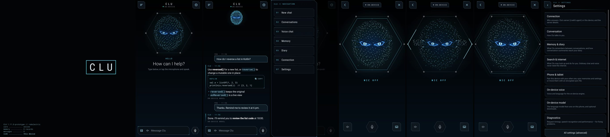

# CLU Android: interface redesign (1.12.0)

Direction: TRON: Legacy restraint × the motion language of eDEX-UI (the reference the owner linked) × CLU's own
identity (its particle presence and its sharp, slightly sinister eyes). Built on the existing UI code: plain Android
Views, no new libraries, fonts, images or recordings in the APK. Everything is drawn or synthesised at run time.

**Not verified on a phone.** Every screen was rendered with Robolectric's native graphics at the iQOO Neo 9 Pro's
resolution, and all automated tests pass. How the animations and sounds feel on the actual devices is still to be
checked with [DEVICE_ACCEPTANCE.md](DEVICE_ACCEPTANCE.md) section S.

*Robolectric renders at 1260×2800 (not device screenshots), made just before the version number and the Interface
settings section were added, so the boot line reads 1.11.0 and Settings doesn't show Interface yet.*

## 1. Audit of the interface before the change

| Part | Where | What it was |
|---|---|---|
| UI architecture | `app/src/main/kotlin/ai/clu/ui` | Programmatic Views (no XML layouts, no Compose). One shared toolkit, `Ui.kt`, holds the palette `C`, the backgrounds and the form builders (`screen`, `titleBar`, `h1`, `p`, `button`, `card`, `field`, `check`, `spinner`, `tappable`). Every screen except chat and voice is built from it |
| Rendering | `View.onDraw` on the platform canvas | Hardware-accelerated by Android |
| CLU's eyes | `HexHudView` | A hexagonal HUD with two angular icy-blue eyes under brow plates, hexagonal irises with a slit, and circuit traces. Its states were idle, listening, thinking, speaking and offline. Used on the voice screen and in the chat's empty state |
| Particle system | `OrbView` | A Fibonacci-sphere particle orb with states. Present in the code but **not used on any screen**. The particle *face* with eyes is the PC's Primus core (`desktop/.../shell/primus`) |
| Chat | `MainActivity` | ListView of plain text rows, emoji controls (🔊 🎤 ■ ↑ ⬡ ☰), and the menu as an AlertDialog list |
| Voice | `VoiceChatActivity` | The HUD, a state label, live words, and three controls |
| Navigation | AlertDialog menu | New chat, Conversations, Voice chat, Memory, Diary, Connection, Settings |
| Motion and sound | none | Activities switched with the system default; no interface sounds |

Baseline: the app suite passed (85 tests) on `b559634` before any change.

## 2. The reference, translated

Studied from the eDEX-UI source (`src/_renderer.js`, `src/assets/css/*.css`, `src/classes/audiofx.class.js`). Its
code, CSS, fonts and sounds are GPL-3.0 and were **not** copied; only the principles were taken.

| eDEX-UI | CLU 1.12 |
|---|---|
| Boot log scrolling line by line with a tick per line, then a "granted" sound | `BootOverlay`: about 0.6 s of CLU's **real** state (version, device, memory count, message count, who answers, sounds on or off), with a soft tick every other line |
| Title screen: the name fades in, flashes filled, becomes outlined, then "derezzes" (horizontal slices jitter) | The name "CLU" goes through the same steps (filled, outlined, a 0.2 s derez in 6 slices), then a scan line passes |
| Main shell opens out of a line (width first, then height) with an "expand" sound; panels fade in column by column | `Motion.expand` (a line widening, then growing to full height) for the top bar, composer and dialogs; `Motion.stagger` for lists, settings and the drawer |
| Augmented-UI panels with clipped corners and thin borders | `Panel`: top-right and bottom-left corners cut at 45°, 1 dp border, a highlight along the top edge, optional corner ticks |
| `cubic-bezier(0.4, 0, 1, 1)`, about 0.5 s fades | Shorter (300–420 ms), decelerating entrances; nothing waits for an animation |
| Sound feedback on every interaction | `Sfx`: soft synthesised tones, off with one switch, silent while listening or speaking |

Not adopted: the terminal, keyboard, globe, system monitors and file browser (unrelated to CLU), and the full-screen
boot length. eDEX's boot takes several seconds; CLU's takes about 1.5 s, and any tap ends it.

## 3. Design system (`ui/Design.kt`, `ui/Ui.kt`, `ui/Icons.kt`)

* **Colour:**
  * near-black background `#020406` and translucent graphite surfaces;
  * electric cyan `#5CE1FF`, ice blue `#A8E8FF` and electric blue `#1E7BFF` as the only light;
  * CLU's original teal `#3FD0C0` kept for the on-device status;
  * amber and red only for warnings and errors.
* **Type:** headings in condensed light sans with wide spacing; body in the system sans; metadata and labels in small
  monospace capitals ("CLU · 14:02", "CLU // SETTINGS").
* **Components:**
  * `Panel` (stateful: pressed brightens the border and adds an inner glow, disabled dims, selected uses the accent);
  * `accentPanel` for primary actions;
  * `HexButtonBg`, a hexagonal main control with a ring that swells with the microphone level;
  * section headers with a cyan tick;
  * title bars with a fading hairline;
  * switches in cyan and graphite;
  * dialogs in the panel style.
* **Icons:** 14 line icons drawn on a 24-unit grid (microphone, send, stop, speaker on/off, image, menu, hexagon, back,
  close, keyboard, copy) instead of emoji.
* **Motion:** `Motion.rise`, `expand`, `stagger` and `press` (a 5 % dip that never consumes the touch). Screens hand
  over with a short fade, and each screen's content rises in. "Reduced motion", or the system's animations turned off,
  shows everything at once.

## 4. CLU's entity (`ui/EntityView.kt`)

`EntityView` is the existing particle system and the existing eyes, together:

* **Particles:** about 1,100 points on a head-shaped shell (Fibonacci distribution, soft inner volume). They move
  organically: noise, breathing, a slow turn of the head. Light is ice blue in front and electric blue behind.
* **Eyes:** the HUD's eyes kept exactly (slanted lids, angled brow plates, hexagonal irises with a vertical slit, circuit
  traces), plus two new behaviours:
  * the irises drift and occasionally glance aside, and look straight at you while listening;
  * the eyes now and then narrow slowly instead of blinking.
* **Frame:** the HUD's hexagonal frame remains as a faint outline with its vertex nodes.

The states come from the engine (`EngineUi`), are never invented, and blend into one another in about 0.3 s:

| State | What it shows |
|---|---|
| Idle | Breathing; dim |
| Listening | The field draws in and brightens with the microphone level; the irises open; a hexagon ring follows the voice |
| Thinking | A sixth of the particles leave the shell and orbit the head; light sweeps the frame and runs along the eye traces |
| Speaking | Ripples run through the field with the level of CLU's real audio; the eyes pulse; hexagons expand outward |
| Offline | The field greys and shrinks; the eyes dim; no frames are drawn once it settles |

**Where it appears:**
* the chat: large while the conversation is empty, then a compact band above it (an animated height change);
* the voice screen: full size.

**Cost:**
* each frame is one pass over the points with no allocation, 12 `drawPoints` calls, and the frame from a cached bitmap;
* about 30 fps while idle, the display rate only while something happens, nothing while hidden;
* about 9 ms per frame on the build host's *software* canvas at 1080×1400 (`InterfaceTest`). Phones draw it on the GPU,
  but that has not been measured.

## 5. Screens

* **Start-up:** the boot sequence once per launch (section 2). The controls work from the first frame, and a tap anywhere
  ends the sequence.
* **Chat (`MainActivity`):**
  * Top bar: navigation, CLU's name with the real link state, and voice.
  * Your messages: right-aligned panels with an ice border and "YOU · time".
  * CLU's replies: a cyan rail, "CLU · time", and the reply rendered from Markdown:
    * headings, bold, italic and inline code;
    * lists and quotes;
    * links (http/https only);
    * code blocks in their own panel with the language, horizontal scrolling and a COPY control.
  * Streaming replies show a caret.
  * Thinking shows a scanning bar and CLU's real status.
  * New rows rise in; history doesn't animate.
  * Sources and memory suggestions are unchanged in behaviour.
  * Problems appear in an amber notice panel with Retry.
* **Image attachments:**
  * The image control picks an image. It is copied into CLU's private storage (at most 1600 px), previewed above the
    composer, removable, and stored with the message.
  * The chat shows it as a thumbnail.
  * An image sent alone asks "What's in this photo?", and CLU answers honestly that it can't see images yet (no vision
    model in this build).
  * Images can't be attached when CLU on the PC answers; the control is dimmed and says why.
* **Voice messages:** unchanged path. The microphone control turns your speech into a message; the hexagonal button
  shows the microphone level.
* **Navigation:** a panel slides in from the left ("CLU // NAVIGATION", numbered entries 01–07, staggered entrance).
  Tap outside or press back to close it.
* **Voice (`VoiceChatActivity`):** the entity full screen, the state in spaced monospace with a session timer, live
  words, and the controls (speaker, hexagonal microphone/stop button, keyboard).
* **Settings and every other screen:** restyled through the shared builders. New section **Settings → Interface** with
  *Interface sounds* and *Interface motion*.

## 6. Sound (`ui/Sfx.kt`)

Synthesised in code (`SfxSynth`), written once to the app cache as WAV, and played with SoundPool on the sonification
stream. There are no recordings and no audio focus is taken.

| Sound | When | Character |
|---|---|---|
| Startup | Boot title | Low swell, three rising glints (A5, D6, A6), 0.95 s |
| Activate | Navigation, voice screen, dialogs | Rising sine sweep, 0.24 s |
| Click | Buttons, switches, links | 30 ms soft tick, rate-limited |
| Tick | Boot log lines | 14 ms, very quiet |
| Listening | Microphone turned on | Rising tone, 0.13 s. It plays *before* the microphone opens (150 ms later), so it never reaches recognition |
| Processing | Message sent | Two short pulses |
| Notification | A reply finished while spoken replies are off | Two soft notes |
| Shutdown | Leaving the app, ending a voice session | Falling sweep |

**Rules:**
* All sounds peak below −9 dBFS, and each starts and ends at silence (tested).
* They are silent whenever the microphone listens, CLU speaks, or a voice session runs (`UiPolicy.interfaceSound`).
* Settings → Interface → *Interface sounds* turns them off.

## 7. Files

* **New:**
  * `app/.../ui/Design.kt`, `Icons.kt`, `EntityView.kt`, `ChatViews.kt` (Markdown views, code panel, processing bar,
    boot overlay), `Markdown.kt`, `ChatImages.kt`, `Sfx.kt`;
  * `app/src/test/.../InterfaceTest.kt`;
  * `core/src/test/.../settings/InterfaceSettingsTest.kt`.
* **Changed:**
  * `Ui.kt` (palette, builders, transitions, dialogs);
  * `MainActivity.kt`, `VoiceChatActivity.kt`, `SettingsActivity.kt` (Interface section);
  * `CluApp.kt` (sound set-up);
  * `voice/Engine.kt` (`send` takes attachments);
  * `core/.../config/Settings.kt` (`ui.sounds`, `ui.motion`), `Policies.kt` (`UiPolicy.interfaceSound`,
    `reducedMotion`), `SimpleSettings.kt` (Interface section);
  * tests `TouchDispatchTest` (the drawer instead of the dialog menu; the entity instead of the HUD) and
    `UiScreenshotTest` (new renders).
* **Removed:**
  * `HexHudView.kt`: its eyes and frame now live in `EntityView`;
  * `OrbView.kt`: unused; its particle approach is the basis of `EntityView`.

No backend, agent, model, voice-pipeline or database changes. `Engine.send` only passes attachments through to the
existing `TurnRequest.attachments`.

## 8. Results (build host)

* Tests: core 702 (16 skipped), app 96, desktop 138 (13 skipped), 0 failures.
* New tests: `InterfaceTest` (6), `InterfaceSettingsTest` (2).
* Adjusted tests: `TouchDispatchTest`, `AppSmokeTest`, `Stage31LifecycleTest` and `ArchiveWorkflowTest` find Send as
  any view (it is now an icon), and use the navigation panel instead of the dialog menu. What each test checks is
  unchanged.
* apiCheck and verifyApk pass; the ICU regex check compiled 649 patterns with 0 rejected.
* Release APK 1.12.0 (versionCode 25) signed with the same certificate.

## 9. Known limits

* Not run on a physical device: animation smoothness, frame cost on the GPU, sound loudness on phone speakers and battery
  impact are unmeasured.
* The first launch after installing may start without sounds: SoundPool loads them in the background.
* The streaming caret doesn't blink (a static caret avoids rebuilding the row twice a second).
* CLU can't see images. Attachments are kept and shown, and CLU says so instead of guessing.
* Dialogs still use the platform's dark Material buttons inside the new panel.

## 10. CLU on Windows (PC 0.10.0)

The PC window (Edge in app mode showing `desktop/.../shell`) has the same redesign.

* **Design (`shell.css`):**
  * the same palette (dark only);
  * chamfered panels, buttons and fields, with hairline borders, corner ticks and focus rings drawn inside the cut corners;
  * a numbered navigation rail (01–12) with the active section lit;
  * "CLU // Section" titles with a fading hairline;
  * condensed headings (Bahnschrift, part of Windows) and monospace labels (Cascadia Mono / Consolas).
* **CLU's face:** the Primus particle head with its eyes stays as it was, full-window behind the interface and following
  CLU's real state. Its rising sparks are now ice and electric blue instead of orange and violet (the only change,
  recorded in `primus/NOTICE.txt`).
* **Start-up (`fx.js`):**
  * the boot log of CLU's real state (version, model, suggestions, voice, sounds), then the name: filled, outlined, derez
    and a scan line;
  * the rail, title bar and composer then open out of a line;
  * once per window, never takes clicks, and any key or click ends it.
* **Chat:**
  * CLU's replies render Markdown (built as DOM nodes, never HTML), with code panels that have Copy;
  * a blinking caret while streaming, and a scanning bar beside the state while thinking;
  * new messages rise in, and sections rise in when opened;
  * "YOU" and "CLU" labels.
* **Sounds:** the same synthesised set, made with the Web Audio API.
  * They are silent while a voice conversation is open.
  * The window starts with `--autoplay-policy=no-user-gesture-required`, so the start-up sound can play.
* **Settings → General:** *Interface sounds* and *Interface motion* (shared registry; changes apply at once). The system's
  reduced-motion preference counts as "Reduced".
* **Tested:** `PrimusShellTest#theRedesignedWindowWorks` drives the real host in Chromium (opt-in `-Dclu.shellUi=<node>`)
  and makes 15 checks:
  * the start-up sequence, the design, the streaming caret, and Markdown and code rendering;
  * entrance motion, the sounds, and the effect of both settings;
  * silence during voice, Markdown safety, and no page errors.
* **Not verified on Windows itself** (tests run Chromium on Linux): Edge's rendering, the Windows fonts, and sound
  output on the PC.
* **Results:**
  * Desktop suite with the opt-in window tests: 139 tests, 138 passed.
  * The one failure was `SpeechEnginesTest` (wake word "Clue" missed in synthesised speech while the browser tests loaded
    the CPU). It passed when re-run on its own, and the recogniser wasn't changed.
* **Installer:** `CLU-Setup-0.10.0.exe`, SHA-256 `2e41f92a…ec15`. Its static checks all pass.
